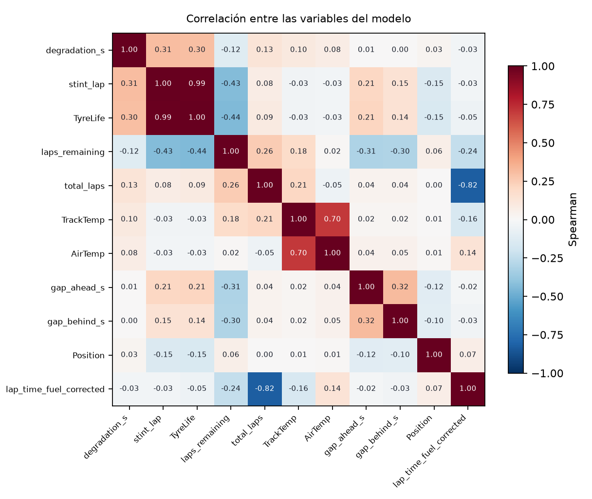
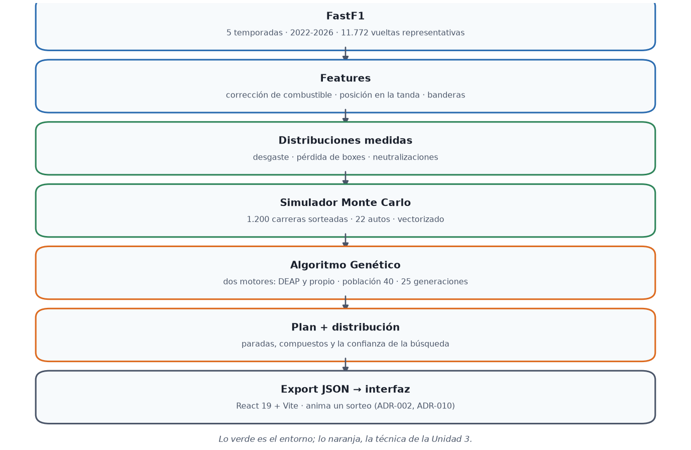
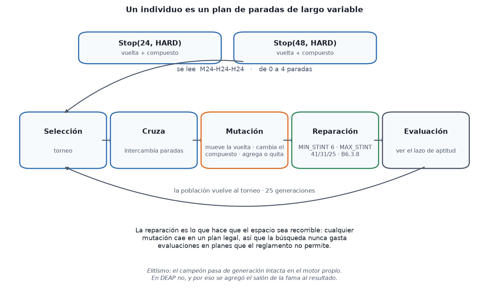
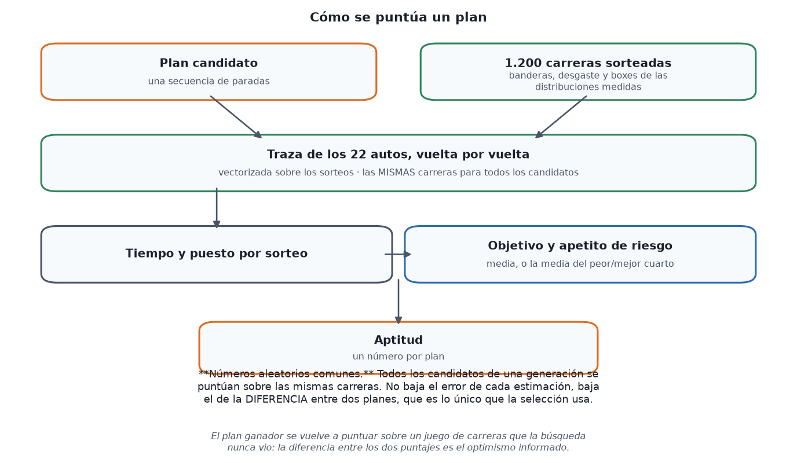
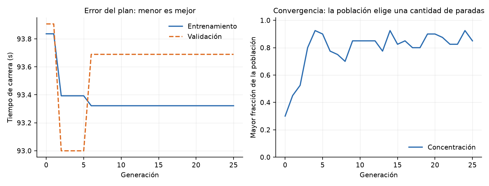
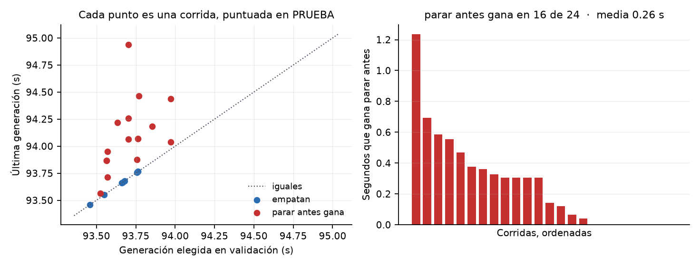
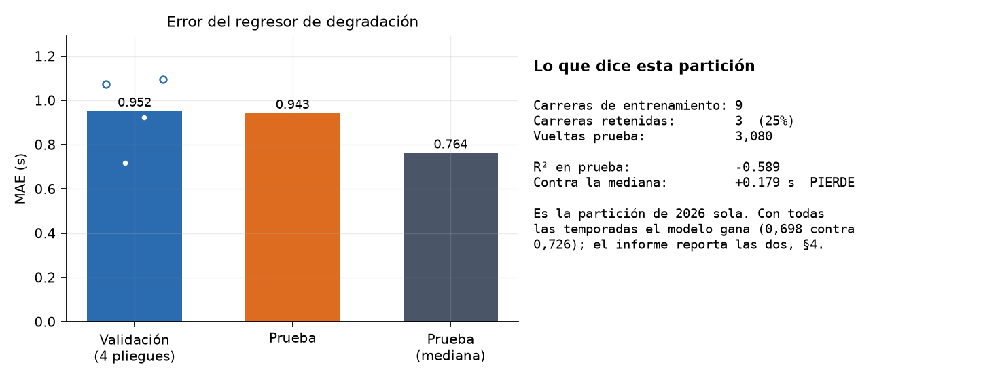
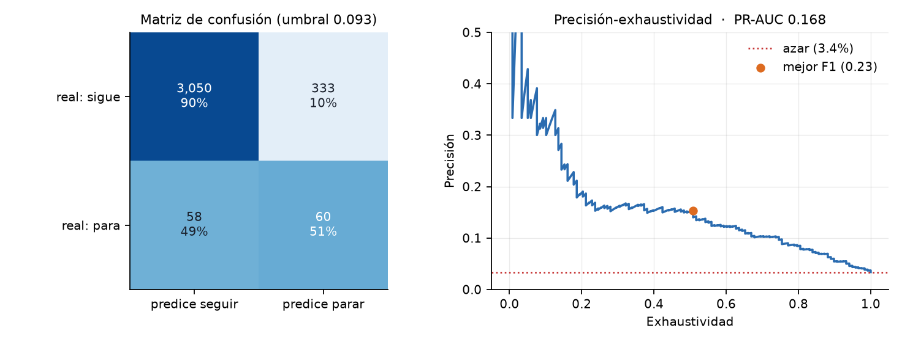

# BoxBox — Estrategia de neumáticos en Fórmula 1

**Trabajo Práctico Integral — Entrega N.º 2: prototipo y evaluación**
Inteligencia Artificial Avanzada — UTN FRBA — 2do Cuatrimestre 2026

| Apellido y Nombres | E-Mail | Aporte |
|---|---|---|
| Sánchez, Tomás Agustín | tosanchez@frba.utn.edu.ar | 100% |

**Fecha de Presentación:** 22 de octubre de 2026

**Repositorio:** https://github.com/tomasanchez/boxbox

---

## Resumen


En una carrera de Fórmula 1 el equipo tiene que decidir cuándo parar en boxes y qué neumático
poner. Este trabajo construye un sistema que **arma ese plan**: cuántas paradas, en qué vueltas y
con qué compuesto. No predice quién gana.

**La pregunta que organiza el informe es si funciona, y la respuesta honesta es que todavía no
como pronosticador.** Se probó contra cuatro carreras reales de 2026 y el marcador es éste:

| Prueba | Veredicto |
|---|---|
| **Monza**, fecha 13 | falló: recomendó una parada, el ganador hizo dos — 18 s de error |
| **Madrid**, fecha 14 | acertó la forma del plan ganador, falló el desgaste por un factor de tres |
| **Compuesto de salida**, grilla de 22 | falló: pone medio 0 de 22 y la realidad lo pone entre 55% y 85% |
| **Bakú**, fecha 15 | 1 de 4 criterios, escritos y commiteados **antes** de la carrera |

Tres de esas cuatro las decidió **una neutralización**. Conviene decir qué significa eso,
porque es la diferencia entre dos problemas: una bandera cambia la estrategia **en tiempo
real**, y lo que este trabajo entrega es un plan **pre-carrera** que sólo puede usar la
**probabilidad** de que esa bandera aparezca. Ahí hay un techo que ningún dato levanta: las distribuciones medidas aciertan *que* va a salir un safety car, no *cuándo*, y el
cuándo es lo que fija el plan. En Monza el 90,6% de las paradas salieron gratis; en Bakú, 35 de
38; en Madrid, un VSC en la vuelta 14 se llevó 10 de 28.

**Lo que sí quedó demostrado, y es un resultado distinto.** En Madrid, volviendo a correr la
búsqueda con el desgaste medido *en la carrera* y sin tocar nada más, propone `M17-H40` contra el
`M14-H43` que hizo el ganador: tres vueltas. **El algoritmo no estaba roto; los insumos sí**, y
eso dice dónde está el retorno y dónde no.

Sobre el método: el sistema le gana **casi once segundos** de carrera a cualquier regla fija que
se pueda enunciar de antemano, genera **cero planes ilegales**, y una medición nueva de esta
entrega muestra que **entrena de más** — parar en la generación que mejor puntúa fuera de muestra
gana 16 de 24 corridas y nunca pierde.

La idea central es un **simulador Monte Carlo** y, sobre él, un **Algoritmo Genético** —con dos
motores, DEAP y uno propio— que busca el mejor plan. El foco es la temporada **2026**, la primera
del nuevo reglamento; agregar las anteriores mejora el modelo un 56%. Como contraste queda
propuesto un **agente de Aprendizaje por Refuerzo**, que corresponde a la Entrega 3.

«Desarrollo» y «Análisis de los Resultados» documentan además los **errores propios** que se encontraron y
corrigieron, porque todos daban números confiados y plausibles hasta que algo aguas abajo salió
absurdo. Uno de ellos cambió una conclusión central del informe anterior.

---

---

## 1. Introducción


Cada vuelta, el ingeniero de estrategia tiene que responder una pregunta simple de enunciar y
difícil de contestar: ¿entro a boxes ahora o sigo?

Si entra, pierde **22,6 segundos** en la mediana —medido sobre las cinco temporadas, y mucho
menos si hay bandera—. Si no entra, pierde tiempo con la goma gastada. Y si sale un Safety Car
justo después, la decisión que parecía buena se convierte en mala.

**Objetivo:** construir un sistema que, para una carrera dada, calcule el plan de neumáticos más
conveniente y explique por qué.

El sistema entrega, para cada piloto:

- **un plan completo**: en qué vueltas parar y qué compuesto calzar en cada parada;
- **cómo se repartió la población de la búsqueda** entre cantidades de parada, que es una medida
  de cuán decidida quedó la respuesta y no una probabilidad de la carrera;
- **una ventana de vueltas** para la parada, expresada en los puestos que cuesta moverla;
- **la distribución de puestos de llegada** sobre las carreras sorteadas, de donde salen las
  probabilidades de ganar, de podio y de puntuar.

**Qué queda afuera:** la gestión de energía. En 2026 la mitad de la potencia es eléctrica y el
manejo de la batería es parte de la estrategia. Pero **la Fórmula 1 no publica esos datos**. Lo
verificamos: los canales de telemetría no los traen. Entonces el sistema trabaja con la parte de
neumáticos y posición, y esto se aclara desde el principio.

---

---

## 2. Materiales Disponibles


De dónde salen los datos, qué se tira y por qué, y qué queda para ajustar. Todo
lo que sigue son las cifras del conjunto real, no una descripción del procedimiento.

#### Volumen por temporada

|   temporada |   carreras |   circuitos |   pilotos |   vueltas |
|------------:|-----------:|------------:|----------:|----------:|
|        2022 |         22 |          22 |        22 |    23,577 |
|        2023 |         22 |          22 |        22 |    24,420 |
|        2024 |         24 |          24 |        24 |    26,604 |
|        2025 |         24 |          24 |        21 |    26,689 |
|        2026 |         14 |          14 |        23 |    16,255 |
| **total** | **106** | | | **117,545** |

Cinco temporadas completas salvo 2026, que está en curso. Las temporadas viejas
entran aunque el reglamento haya cambiado: se midió que agregarlas baja el error
del modelo de degradación un 56%, y ese resultado está en «Desarrollo».

### Datos

Se usa la librería **`fastf1`** de Python, que da los datos oficiales de cronometraje.

Las columnas que importan (compuesto, edad del neumático, número de stint, estado de pista)
están completas al 100%. De 2026 salen 14.095 vueltas, 756 stints (tandas con un juego de gomas)
y 527 paradas.

### Cómo quedó armado el conjunto de datos

`fastf1` tiene un tope de **500 llamadas por hora**. Al bajar varias temporadas de una vez, el
tope se alcanza a mitad de camino y las carreras restantes se descartan **sin aviso**. Nos pasó:
durante un tiempo el caché tenía 2023 y 2024 cortadas por la mitad y **2025 no estaba en
absoluto**, no por criterio sino por accidente.

Se descargó lo que faltaba por tandas. Estado actual:

| Temporada | Calendario | Descargadas | Estado |
|---|---|---|---|
| 2022 | 22 | 22 | Completa |
| 2023 | 22 | 22 | Completa |
| 2024 | 24 | 24 | Completa |
| 2025 | 24 | 24 | Completa |
| 2026 | 23 | 12 | Al día — la temporada está en curso |
| **Total** | | **104 carreras** | ~112.000 vueltas |

Vale la pena dejar constancia de dos cosas que aprendimos ahí:

**El caché incompleto sesgaba las estimaciones sin que se notara.** De 2023 y 2024 teníamos sólo
la primera mitad del año, así que los circuitos de fin de temporada —Austin, México, Brasil, Las
Vegas, Qatar— estaban sub-representados. Al completar los datos, la degradación medida del
compuesto blando en 2023 pasó de 0,0664 a **0,0403 s/vuelta**. Era un 60% de error, invisible
hasta que se comparó.

**Un tope de API que descarta en silencio es un riesgo de datos, no una molestia técnica.** Por
eso el proceso de descarga ahora informa cuántas carreras trajo y cuántas falló.

### Qué datos se usan para qué

Al principio decidimos usar **sólo 2026**, porque este año se invirtió el orden de desgaste de
los compuestos: el blando pasó de ser el que más se gastaba al que menos. La idea era que
entrenar con años anteriores le enseñaría al modelo lo contrario de lo que pasa hoy.

**Lo medimos y la decisión estaba mal.** Entrenando y probando siempre sobre las mismas carreras
de 2026:

| Entrenamiento | Vueltas | PR-AUC | Sobre el azar |
|---|---|---|---|
| Sólo 2026 | 10.143 | 0,1430 | 4,24× |
| **Con 2022–2025 sumadas** | **107.308** | **0,2238** | **6,64×** |

Mezclar mejora un **56%**. El error de razonamiento fue este: la inversión afecta **una** de las
diecinueve variables. Las otras —diferencias con los rivales, vuelta del stint, vueltas
restantes, estado de pista— sirven igual en cualquier temporada.

Probamos también agregar la temporada como variable, para que el modelo pudiera distinguir las
eras. **Empeora** (0,1896 contra 0,2238). Aprende mejor los patrones generales si no se lo invita
a separar por año.

Así que la regla no es global, **depende del componente**:

| Para qué | Qué datos | Por qué |
|---|---|---|
| Entrenar los modelos | Todas las temporadas | Medido: 56% mejor |
| Tasas de Safety Car por circuito | Todas las temporadas | Con 12 carreras hay **una sola visita** por circuito; con una temporada es imposible estimarlo |
| Costo de parar en boxes | Todas las temporadas | Depende del largo del pit lane, no del auto |
| **Desgaste por compuesto** | **Sólo 2026** | Acá sí cambió el comportamiento |
| **Efecto del combustible** | **Sólo 2026** | Los autos son ~32 kg más livianos |
| Reglamento | **Sólo 2026** | El artículo B6.3.8 es de este año |

Conviene aclarar que el trabajo **sigue siendo sobre 2026**. Lo nuevo es la temporada que se
analiza y se pronostica, no la cantidad de datos con la que se entrena. Usar menos datos para
poder decir "sólo 2026" habría sido perder precisión a cambio de una frase.

También se usa el **Reglamento Deportivo 2026 de la FIA**, que obliga a usar al menos dos
compuestos distintos de seco por carrera. Si no se cumple, el piloto queda descalificado.

### Preparación de los datos

Al armar el pipeline aparecieron cuatro problemas que hay que corregir sí o sí:

**1. Las vueltas de entrada y salida de boxes no sirven para medir ritmo.** Incluyen el paso por
el pit lane. Se marcan aparte. Quedan usables el 90% de las vueltas.

**2. El combustible.** Un auto con más nafta es más lento. Se resta ese efecto para poder
comparar la vuelta 8 con la vuelta 45.

**3. `TyreLife` no es lo mismo que "vueltas de este stint".** Un piloto que arranca con gomas ya
usadas en clasificación empieza la carrera con `TyreLife = 4`. Y no pasa sólo en la largada: un
equipo puede calzar un juego usado en cualquier parada, y de hecho lo hace. Medido sobre las
95.595 vueltas secas representativas, **las dos columnas coinciden en el 80,7%** —todas las de
juego nuevo— y difieren en el 19,3% restante, con una mediana de 2 vueltas y un máximo de 25.
Hay que contar las vueltas dentro del stint aparte.

**4. Los cambios de goma bajo bandera roja son gratis.** Con la carrera detenida, cambiar
neumáticos no cuesta tiempo. En Zandvoort 2026, 21 de 22 pilotos "pararon" en la vuelta 2 por una
bandera roja. Si eso se mezcla con las paradas normales, el modelo aprende que parar a veces sale
gratis. Se separan en dos etiquetas distintas.

### Limpieza: qué se descarta y por qué

#### Embudo de filtrado

| paso                     |   vueltas | % del crudo   | pierde   | qué exige                                                                                                               |
|:-------------------------|----------:|:--------------|:---------|:------------------------------------------------------------------------------------------------------------------------|
| vueltas crudas de FastF1 |   117,545 | 100.0%        | —        | todo lo que devuelve la API                                                                                             |
| con tiempo de vuelta     |   115,715 | 98.4%         | 1,830    | descarta abandonos y vueltas sin cronometrar                                                                            |
| representativas          |   101,273 | 86.2%         | 14,442   | y además: no es entrada ni salida de boxes, no fue borrada por los comisarios, y pasa el control `IsAccurate` de FastF1 |
| en seco                  |    95,782 | 81.5%         | 5,491    | fuera intermedio y lluvia, que el simulador no representa                                                               |

**No hay un paso «en verde» aparte, y conviene explicar por qué.** De las 8,571 vueltas corridas bajo alguna bandera, **todas fallan el control `IsAccurate` de FastF1**, así que el filtro de representativas ya se las llevó: quedan 0 vueltas neutralizadas en el conjunto de ajuste. Filtrar por bandera después no saca ninguna fila más: es redundante, no incorrecto.

Y el objetivo `degradation_s` resulta no nulo **exactamente** en esas mismas 101,273 filas, porque se calcula contra una referencia que sólo existe cuando la tanda tiene vueltas representativas.

Los **14.442** que se pierden en el paso de representativas son, en orden de
volumen: vueltas bajo bandera (que FastF1 marca imprecisas), entradas y salidas
de boxes —que llevan el tránsito del pit lane y no describen ritmo— y vueltas
anuladas por los comisarios. Ninguna se borra del conjunto: se marcan, porque una
vuelta de entrada a boxes es inservible para medir ritmo y es **exactamente** donde
vive la etiqueta de «paró».

### La matriz de variables

#### La matriz de columnas · 19 variables sobre 101,273 vueltas en verde

| columna                    | qué es                                                    | tipo    | nulos   | mín · mediana · máx                  | rol                                  |
|:---------------------------|:----------------------------------------------------------|:--------|:--------|:-------------------------------------|:-------------------------------------|
| stint_lap                  | vuelta dentro de la tanda, 1 en la primera                | int64   | 0.0%    | 1.0 … 13.0 … 77.0                    | regresor                             |
| TyreLife                   | vueltas que lleva el juego, incluye las de práctica       | float64 | 0.8%    | 1.0 … 13.0 … 78.0                    | regresor                             |
| laps_remaining             | vueltas que faltan para la bandera                        | float64 | 0.0%    | 0.0 … 30.0 … 76.0                    | regresor                             |
| TrackTemp                  | temperatura de pista (°C)                                 | float64 | 0.0%    | 15.6 … 35.5 … 57.5                   | regresor                             |
| AirTemp                    | temperatura del aire (°C)                                 | float64 | 0.0%    | 12.1 … 24.5 … 37.2                   | regresor                             |
| Compound                   | blando / medio / duro                                     | object  | 0.0%    | 7 valores · más común HARD (46%)     | regresor                             |
| total_laps                 | largo de la carrera                                       | float64 | 0.0%    | 29.0 … 58.0 … 78.0                   | clasificador                         |
| FreshTyre                  | el juego salió nuevo                                      | bool    | 0.0%    | 2 valores · más común True (80%)     | clasificador                         |
| is_neutralised             | la vuelta corrió bajo alguna bandera                      | bool    | 0.0%    | 2 valores · más común False (93%)    | clasificador                         |
| sc                         | safety car                                                | bool    | 0.0%    | 2 valores · más común False (95%)    | clasificador                         |
| vsc                        | safety car virtual                                        | bool    | 0.0%    | 2 valores · más común False (98%)    | clasificador                         |
| yellow                     | bandera amarilla                                          | bool    | 0.0%    | 2 valores · más común False (95%)    | clasificador                         |
| circuit                    | el trazado                                                | object  | 0.0%    | 28 valores · más común Budapest (6%) | clasificador                         |
| degradation_s              | segundos perdidos contra la referencia de la propia tanda | float64 | 0.0%    | -31.1 … 0.3 … 68.9                   | clasificador (de la vuelta anterior) |
| degradation_rate_s_per_lap | pendiente de esa caída                                    | float64 | 5.6%    | -69.0 … 0.0 … 15.1                   | clasificador (de la vuelta anterior) |
| lap_time_fuel_corrected    | vuelta con el efecto de combustible descontado            | float64 | 0.0%    | 65.8 … 85.3 … 146.6                  | clasificador (de la vuelta anterior) |
| gap_ahead_s                | hueco al auto de adelante                                 | float64 | 5.5%    | 0.0 … 2.4 … 1144.7                   | clasificador (de la vuelta anterior) |
| gap_behind_s               | hueco al de atrás                                         | float64 | 4.9%    | -848.7 … 2.4 … 3916.2                | clasificador (de la vuelta anterior) |
| Position                   | puesto en esa vuelta                                      | float64 | 0.0%    | 1.0 … 10.0 … 22.0                    | clasificador (de la vuelta anterior) |

Las tres primeras filas del regresor y las seis retardadas del clasificador son
las que llevan información; el resto es contexto. El rol «de la vuelta anterior»
no es un detalle: el clasificador tiene que decidir **antes** de ver la vuelta, así
que consume el valor desplazado un lugar y nunca el de la vuelta que predice.

### Qué se intenta predecir

#### El objetivo: `degradation_s`, segundos perdidos contra la referencia de la tanda

| compuesto   |   vueltas |    p10 |   mediana |   p90 |   desvio |
|:------------|----------:|-------:|----------:|------:|---------:|
| HARD        |    46,664 | -0.623 |     0.391 | 1.88  |    1.61  |
| MEDIUM      |    36,717 | -0.67  |     0.335 | 1.679 |    1.857 |
| SOFT        |    12,401 | -0.566 |     0.419 | 1.796 |    3.086 |

El desvío es **mayor que la mediana en los tres compuestos**: la incertidumbre de una vuelta es más grande que la señal que se intenta predecir, y eso es lo que justifica simular en vez de estimar un valor puntual.


### Las variables entre sí



#### Matriz de correlación de Spearman · 95,782 vueltas

|                         |   degradation_s |   stint_lap |   TyreLife |   laps_remaining |   total_laps |   TrackTemp |   AirTemp |   gap_ahead_s |   gap_behind_s |   Position |   lap_time_fuel_corrected |
|:------------------------|----------------:|------------:|-----------:|-----------------:|-------------:|------------:|----------:|--------------:|---------------:|-----------:|--------------------------:|
| degradation_s           |            1    |        0.31 |       0.3  |            -0.12 |         0.13 |        0.1  |      0.08 |          0.01 |           0    |       0.03 |                     -0.03 |
| stint_lap               |            0.31 |        1    |       0.99 |            -0.43 |         0.08 |       -0.03 |     -0.03 |          0.21 |           0.15 |      -0.15 |                     -0.03 |
| TyreLife                |            0.3  |        0.99 |       1    |            -0.44 |         0.09 |       -0.03 |     -0.03 |          0.21 |           0.14 |      -0.15 |                     -0.05 |
| laps_remaining          |           -0.12 |       -0.43 |      -0.44 |             1    |         0.26 |        0.18 |      0.02 |         -0.31 |          -0.3  |       0.06 |                     -0.24 |
| total_laps              |            0.13 |        0.08 |       0.09 |             0.26 |         1    |        0.21 |     -0.05 |          0.04 |           0.04 |       0    |                     -0.82 |
| TrackTemp               |            0.1  |       -0.03 |      -0.03 |             0.18 |         0.21 |        1    |      0.7  |          0.02 |           0.02 |       0.01 |                     -0.16 |
| AirTemp                 |            0.08 |       -0.03 |      -0.03 |             0.02 |        -0.05 |        0.7  |      1    |          0.04 |           0.05 |       0.01 |                      0.14 |
| gap_ahead_s             |            0.01 |        0.21 |       0.21 |            -0.31 |         0.04 |        0.02 |      0.04 |          1    |           0.32 |      -0.12 |                     -0.02 |
| gap_behind_s            |            0    |        0.15 |       0.14 |            -0.3  |         0.04 |        0.02 |      0.05 |          0.32 |           1    |      -0.1  |                     -0.03 |
| Position                |            0.03 |       -0.15 |      -0.15 |             0.06 |         0    |        0.01 |      0.01 |         -0.12 |          -0.1  |       1    |                      0.07 |
| lap_time_fuel_corrected |           -0.03 |       -0.03 |      -0.05 |            -0.24 |        -0.82 |       -0.16 |      0.14 |         -0.02 |          -0.03 |       0.07 |                      1    |

Spearman y no Pearson porque varias columnas tienen colas largas —el hueco al de
adelante llega a 1.144 s— y una correlación lineal las dejaría dominar.

**Tres cosas salen de acá, y las tres cambian cómo hay que leer los resultados.**

1. **`stint_lap` y `TyreLife` correlacionan 0,99, pero no son la misma variable**, y
   la diferencia es la de arriba: vueltas de la tanda contra vueltas del juego. El
   0,99 global esconde dos poblaciones:

   | | vueltas | coinciden | correlación |
   |---|---|---|---|
   | juego **nuevo** (`FreshTyre`) | 77.108 · 80,7% | **100%** | 1,000 |
   | juego **usado** | 18.487 · 19,3% | 8,2% | 0,966 |

   En cuatro de cada cinco vueltas son **idénticas por construcción**; en la quinta
   difieren una mediana de 2 vueltas y hasta 25. O sea que la redundancia es real
   pero **de tres columnas y no de dos**: `stint_lap`, `TyreLife` y `FreshTyre`
   guardan entre las tres la información que dos ya determinan. Tener las dos
   primeras en el regresor reparte la importancia de la misma señal entre dos
   columnas en el 80,7% de los casos, y sólo aporta algo distinto en el 19,3%
   restante — que es, justamente, donde el modelo más necesitaría acertar, porque
   un juego usado se degrada desde un punto que no es cero.
2. **`total_laps` y el tiempo de vuelta correlacionan −0,82**, que es una identidad
   disfrazada: las carreras largas son las de vuelta corta. Y las dos temperaturas
   van a 0,70 entre sí.
3. **El objetivo no correlaciona con nada por encima de 0,31.** Ésa es la cifra que
   explica el resto del trabajo: el mejor predictor individual del desgaste de una
   vuelta apenas lo roza, y todos los demás quedan en 0,13 o menos. Un regresor
   sobre estas columnas no puede ir mucho más allá de la mediana — y la sección de
   «Desarrollo» muestra que, en efecto, no va.

Eso **no** invalida el enfoque: lo redirige. Si el valor de una vuelta no se puede
predecir, lo que queda es describir bien su *distribución* y simular. Es la decisión
de diseño central del trabajo y acá está su justificación numérica.

### Dónde hay datos y dónde no

#### Cobertura 2026 por circuito y compuesto (vueltas en verde con objetivo medible)

| circuito          |   blando |   medio |   duro |   total |
|:------------------|---------:|--------:|-------:|--------:|
| Budapest          |      312 |     343 |    617 |    1272 |
| Monte Carlo       |      254 |     600 |    323 |    1177 |
| Spielberg         |      131 |     498 |    535 |    1164 |
| Zandvoort         |      339 |     198 |    582 |    1119 |
| Montréal          |      442 |     540 |     62 |    1044 |
| Barcelona         |      118 |     258 |    659 |    1035 |
| Madrid            |       75 |     155 |    781 |    1011 |
| Suzuka            |        0 |     432 |    491 |     923 |
| Monza             |       75 |     370 |    469 |     914 |
| Miami Gardens     |       55 |     356 |    447 |     858 |
| Silverstone       |       14 |     463 |    379 |     856 |
| Melbourne         |      112 |     223 |    500 |     835 |
| Shanghai          |       15 |     146 |    655 |     816 |
| Spa-Francorchamps |       62 |     160 |    481 |     703 |

**1 celdas vacías** de 42. Un circuito sin celdas propias se corre con el promedio de la temporada, que es exactamente lo que se hizo con Madrid y con Bakú.


### Cómo se separan los datos

**Se separa por carrera, no por vuelta.** Dos vueltas seguidas de la misma tanda son casi
iguales; si quedan una en entrenamiento y otra en prueba, el modelo hace trampa sin querer.

**La prueba se hace siempre sobre 2026.** No tendría sentido medir en 2024 un sistema pensado
para el reglamento de este año.

Se reservan **las últimas 3 carreras de 2026 de las 12 disponibles: el 25%**. Se eligen las más
recientes y no tres al azar, porque eso se parece a lo que el sistema tiene que hacer realmente:
predecir carreras que todavía no pasaron.

| | Carreras | Vueltas | Paradas |
|---|---|---|---|
| **Prueba** — 2026 R10–12 | **3 de 12 de 2026 (25%)** | **3.501** | **118** |
| Entrenamiento — 2026 R1–9 | 9 | 10.143 | 350 |
| Entrenamiento — más 2022–2025 | 92 | 97.165 | ~3.000 |

O sea: el 25% de prueba se cumple sobre las carreras de 2026, que es el universo que importa. Las
temporadas anteriores **sólo entran en entrenamiento**, nunca en prueba.

Dentro del entrenamiento se valida con `GroupKFold` agrupando por carrera, así ninguna carrera
aparece a la vez en entrenamiento y validación.

---

---

## 3. Solución Propuesta


Tres piezas:

**1. Simulador de carrera (la base).** Simula una carrera vuelta a vuelta: cuánto se degrada cada
goma, cuánto cuesta parar, y si sale o no un Safety Car. Se corre miles de veces para ver todos
los escenarios posibles. No es una técnica de IA: es el banco de pruebas de las que sí lo son.

**2. Algoritmo Genético (la técnica principal — Unidad 3).**

Un algoritmo genético busca la mejor solución imitando la evolución: prueba muchas opciones, se
queda con las mejores, las combina entre sí y repite el proceso muchas veces.

Acá cada "individuo" es **un plan de carrera completo**. Por ejemplo:

> *Arrancar con neumático Medio y parar en la vuelta 18. Poner Duro y parar en la vuelta 43.
> Terminar con Blando.*

En corto: se parte de **40 planes** —los obvios, sembrados a mano, más otros al azar—, se
le pone una nota a cada uno simulando 1.200 carreras, se conservan los mejores, se combinan y se
mutan, y el ciclo se repite **25 generaciones**. La nota la da la **función de aptitud**, y qué
cuenta como «mejor» es configurable: tiempo de carrera, puesto de llegada, puntos, o
probabilidad de entrar a los diez.

**El reglamento no actúa como filtro, actúa como reparador**, y la diferencia importa. Un plan
que usaría un solo compuesto seco no se descarta: se le **cambia el compuesto de la última
parada** por uno que el auto no haya usado, y vuelve a competir ya legal. Descartarlo sesgaría
la búsqueda hacia lo que resultó legal por casualidad; repararlo conserva la idea y la hace
ejecutable. Por eso la cantidad de planes ilegales generados es **cero** y no hace falta
penalizarlos en la aptitud.

La mecánica completa —la codificación del individuo, el elitismo, la cruza cortando por vuelta,
la regla de mutación con sus cuatro casos y sus probabilidades, y el orden en que el reparador
impone cada restricción— está más abajo, en «Cómo funciona el algoritmo genético».

**Sobre DEAP.** La propuesta decía que se iba a usar DEAP, la librería que recomienda la
cátedra. La implementación se escribió primero a medida, porque el genoma es de largo variable
—un plan tiene de cero a cuatro paradas— y necesita reglas de reparación propias: ordenar las
paradas, separarlas al menos seis vueltas y forzar una parada cuando la tanda excede lo que la
evidencia puede cotizar. Eso no encaja cómodo en los operadores estándar.

**Ya está portado, y los dos motores conviven.** Se elige con un parámetro.

> **Qué motor produjo los números de este informe, porque conviene decirlo sin
> rodeos: el propio.** Las dos implementaciones existen y las dos funcionan —
> `boxbox_ml.deap_search` importa `algorithms`, `base`, `creator` y `tools` de
> DEAP, y se activa con `engine="deap"`— pero el valor por omisión es `builtin`,
> y el export que alimenta todas las cifras publicadas lo anota así en su
> metadata: `"engine": "builtin"`.
>
> **DEAP se usa para contrastar, no para producir.** La comparación de más abajo
> es su razón de ser: sobre 75 problemas los dos motores dan el mismo plan en el
> 81,3% de los casos y ninguno le gana al otro de forma sistemática, así que
> elegir uno u otro no cambia la respuesta — y el propio es un 20% más rápido.
> Habiendo medido eso, producir con el motor propio es una decisión justificada
> y no una omisión.

El port es
deliberadamente un re-alojamiento y no un rediseño: las semillas, la aptitud con números
aleatorios comunes, el reparador, la cruza y la mutación son los mismos objetos; lo único que
cambia es el bucle, que pasa a ser `eaMuPlusLambda` con selección por torneo. Los operadores de
caja de DEAP no sirven acá —`cxTwoPoint` asume largo fijo y no sabe de restricciones— así que se
registran los propios en un `Toolbox`, que es la forma en que se espera leer un algoritmo
genético.

Dos cosas que el port enseñó. La primera: **el caché de aptitud de DEAP acá es correcto**, y no
era obvio. DEAP no reevalúa un individuo cuya aptitud sigue válida, lo cual es el error clásico
con Monte Carlo; pero la nuestra usa números aleatorios comunes con semilla fija, así que para un
plan dado es determinística. La segunda salió de verificar: **`eaMuPlusLambda` y `selTournament`
usan el generador global de `random`, que nunca sembrábamos**, así que el motor DEAP era no
determinístico y dos corridas idénticas daban planes distintos. Está sembrado desde el mismo
generador que ya comparte la búsqueda.

Verificado sobre 75 problemas —tres compuestos de salida, cuatro posiciones de grilla, tres
apetitos de riesgo, cinco semillas— comparando el puntaje fuera de muestra: **DEAP gana 9, el
motor propio 2, empatan 64**, con el mismo plan exacto en el **81,3%** de los casos. Ninguno le
gana al otro de forma sistemática; DEAP cuesta 6,74 s por búsqueda contra 5,36 s.

> **Esta comparación se rehízo, porque la primera estaba viciada.** Decía «DEAP gana 7, el propio
> 6, empatan 62» con 74,7% de acuerdo, y se corrió cuando el motor DEAP todavía **descartaba su
> salón de la fama**: podía devolver un plan peor que el mejor que él mismo había encontrado. Parte
> de lo que el motor propio le ganaba era eso. Corregido, DEAP sube y el acuerdo también, que es lo
> que uno espera si el defecto era ruido de selección y no exploración distinta.

Dos lecciones de método salieron del propio experimento, y las dos son sobre **cuándo una
comparación significa algo**.

**«Mismo plan» sólo vale donde la aptitud discrimina.** El auto vigésimo con apetito conservador
tiene 0% de acuerdo entre motores y puntaje idéntico −20,000 en los dos — termina vigésimo haga lo
que haga, así que todos los planes empatan y cada motor se queda con uno distinto.

**Y «mismo puntaje» sólo vale donde los dos miden en la misma unidad.** Doce de los quince grupos
de problemas coinciden dentro de 0,06; los tres restantes son todos el auto que larga
decimotercero, justo en la burbuja de los puntos, y ahí los puntajes son −5,092 contra 0,193. No
es que un motor encuentre algo mucho mejor: es que el objetivo **adaptativo** resolvió distinto en
cada uno —uno terminó puntuando en puestos y el otro en puntos— y esos dos números no se pueden
restar. La diferencia absoluta media de 0,86 que reporta el script es esa resta, y no mide
calidad. Sin P13 es de seis milésimas.

**3. Agente de Aprendizaje por Refuerzo (Unidad 5) — ⚠️ NO CONSTRUIDO.**

> **Esto no existe todavía: no hay una sola línea de código de aprendizaje por
> refuerzo en el repositorio.** Se describe acá porque es la comparación que el
> trabajo propone y porque la Unidad 5 del programa se dicta para la Entrega 3,
> no porque forme parte de lo que se entrega hoy. Los puntos 1 y 2 de arriba sí
> están construidos y medidos; éste es un plan.

El algoritmo genético arma el plan **antes de largar**. Pero en una carrera real las cosas
cambian: sale un Safety Car, empieza a llover, un rival para antes de lo previsto. Un agente de
aprendizaje por refuerzo decidiría **sobre la marcha**.

La idea es la de enseñarle a jugar a alguien que no sabe las reglas, sólo si le fue bien o mal:

1. **El agente ve el estado de la carrera** en cada vuelta: en qué posición está, cuánto se
   degradó su goma, a cuánto tiene al de adelante y al de atrás, si hay Safety Car.
2. **Elige una acción:** seguir en pista, o boxear y con qué compuesto.
3. **Se simula la carrera hasta el final** y se le da un **premio**: las posiciones que ganó o
   perdió.
4. **Se repite miles de carreras.** Al principio decide cualquier cosa. Con el tiempo aprende
   solo que boxear con Safety Car sale barato y que quedarse demasiado con la goma gastada sale
   caro. Nadie se lo programó: lo dedujo de los premios.

La demo de la cátedra sobre Blackjack (`Q-Blackjack.ipynb`) es el mismo problema con otra ropa:
decidir "pido carta o me planto" bajo incertidumbre, donde seguir conviene hasta cierto punto y
después arruina la mano. Cambiar eso por "sigo o boxeo" es casi cambiarle el nombre.

**Lo interesante es la comparación:** planificar todo de antemano (el genético) contra reaccionar
a lo que va pasando (el agente). Cuál gana, y en qué tipo de carreras gana cada uno, es en sí un
resultado del trabajo.

La idea es envolver el simulador en la interfaz **`gymnasium`**, que es la que usa la demo de
la cátedra, para que sirva a las dos técnicas sin escribirlo dos veces. **Todavía no está
hecho:** el simulador de hoy expone funciones de NumPy vectorizadas sobre los sorteos, no un
entorno con `reset()` y `step()`, y ningún módulo importa `gymnasium`.

**Herramientas que se usan hoy:** Python 3.13, `fastf1`, `pandas`, `numpy`, `DEAP`,
`LightGBM`, `scikit-learn`, `matplotlib`, y del lado de la interfaz React 19, Vite y MUI.
Cuadernos Jupyter —locales, vía `jupytext`— para dejar el cálculo a la vista.

**Declaradas y todavía sin usar:** `gymnasium`, que figura en las dependencias y que no importa
ningún módulo; está puesta para el agente de la Entrega 3. Se la nombra acá en vez de esconderla
porque una dependencia declarada que nadie usa es una promesa, no una herramienta.

**Línea futura:** una red bayesiana con `pgmpy` para modelar la incertidumbre del Safety Car. Se
declara como línea futura y no como promesa: el trabajo es individual y prometer cuatro técnicas
para entregar una es peor que proponer dos y cumplirlas.

---

### Cómo funciona el algoritmo genético

**El individuo.** Un plan es una secuencia de paradas de largo variable, de cero a
cuatro. Cada parada lleva dos cosas: la vuelta en la que entra y el compuesto que
calza. No hay codificación binaria ni vector de largo fijo: el genoma *es* el plan.

**La población inicial** no es puramente al azar. Se siembra con los planes obvios
—repartir la distancia en partes iguales para una, dos, tres y cuatro paradas, al
compuesto más duradero— y el resto se completa con planes aleatorios. Sembrar
importa: ciento dieciocho planes de dos paradas al azar dieron como mejor 93,3 s
contra 91,0 del reparto parejo hecho a mano.

**Selección: elitismo explícito.** Cada generación se ordena por aptitud y la cuarta
parte superior —diez de cuarenta— pasa **intacta**. Los hijos se arman tomando un
padre de esa élite y el otro de la población entera, así que el campeón nunca se
pierde. Es la diferencia con el motor de DEAP, que usa `selTournament` dentro de
`eaMuPlusLambda` y **no** garantiza que el mejor sobreviva.

**Cruza en un punto, cortando por vuelta y no por índice.** Se sortea una vuelta de
corte y el hijo hereda las paradas anteriores al corte de un padre y las
posteriores del otro. Cortar por vuelta es lo que hace que el hijo tenga una
primera mitad de carrera coherente y una segunda mitad coherente, en vez de
intercalar dos planes que no tienen nada que ver.

**La regla de mutación**, que se aplica al 60% de los hijos. Se sortea un número
entre 0 y 1 y se hace una sola de cuatro cosas:

| Sorteo | Operación | Condición |
|---|---|---|
| < 0,15 | **agrega** una parada en una vuelta al azar, con compuesto al azar | si tiene menos de 4 |
| 0,15 – 0,30 | **quita** una parada al azar | si tiene alguna |
| 0,30 – 0,65 | **mueve** una parada entre −6 y +6 vueltas | si tiene alguna |
| > 0,65 | **cambia el compuesto** de una parada | si tiene alguna |

O sea: 15% agregar, 15% quitar, 35% mover y 35% recompuestar. Las dos primeras
cambian *cuántas* paradas y las dos últimas, *cómo* son. La ventana de ±6 vueltas
es deliberadamente chica: mover una parada treinta vueltas produce otro plan
distinto, no una variación del mismo, y eso es cruza y no mutación.

**Reparación, después de cada operador.** Es la pieza que no es estándar y la que
hace que el espacio sea recorrible. Todo hijo pasa por un reparador que impone, en
este orden: paradas ordenadas y separadas por al menos 6 vueltas; ninguna tanda más
larga que la vida medida de su compuesto (41 el duro, 31 el medio, 25 el blando);
ninguna parada tan tarde que no quede carrera para amortizarla; y los **dos
compuestos secos** que exige el artículo B6.3.8.

Sin reparación, la mayoría de la población sería ilegal y la búsqueda gastaría sus
evaluaciones en planes que ningún comisario dejaría correr. Con ella, **cualquier**
mutación cae en un plan válido, y por eso la tasa de planes ilegales generados es
cero y no hace falta penalizarlos en la aptitud.

**El ciclo completo** son 25 generaciones de 40 individuos: 1.040 evaluaciones, cada
una sobre 1.200 carreras sorteadas.

### La topología del sistema

Un trabajo de redes neuronales muestra acá su pila de capas. La técnica de éste
es un algoritmo genético sobre un simulador, así que la «topología» son tres
cosas distintas y amontonarlas en un diagrama las haría ilegibles. Las tres se
describen abajo.

**De dónde salen los datos y en qué se convierten.**



**Cómo se codifica un individuo y qué le hacen los operadores.** Es el análogo
más directo de la topología de una red, porque es lo que define el espacio que la
búsqueda recorre: un plan es una secuencia de paradas de **largo variable**, de
cero a cuatro, y cada gen lleva una vuelta y un compuesto.



La pieza que no es estándar es la **reparación**. Cualquier mutación cae en un
plan legal —separación mínima entre paradas, vida máxima de cada juego, y los dos
compuestos secos que exige B6.3.8— así que la búsqueda nunca gasta evaluaciones
en planes que el reglamento no permite. Sin ella, la mayor parte de la población
sería inválida y el espacio dejaría de ser recorrible por mutación.

**Cómo se puntúa un plan**, que es donde vive el simulador:




---

---

## 4. Desarrollo

Qué pasó al aplicar lo anterior: con qué parámetros se corrió, qué dio, y los
problemas que aparecieron en el camino con lo que se hizo para resolverlos. Las
pruebas contra carreras reales —que son la evaluación del sistema y no una corrida
más— van en la sección siguiente.

### Las corridas: qué parámetros se probaron

Cinco semillas por combinación, todas juzgadas sobre las **mismas 20.000 carreras
retenidas** — si el árbitro fuera tan ruidoso como lo que juzga, la tabla no
diría nada.

| # | Sorteos | Población | Generaciones | Evaluaciones | Tiempo medio | Dispersión entre semillas | |
|---|---|---|---|---|---|---|---|
| 1 | 200 | 40 | 25 | 1.040 | 94,36 s | 0,51 | |
| 2 | 400 | 40 | 25 | 1.040 | 94,05 s | 0,40 | |
| 3 | 800 | 40 | 25 | 1.040 | **93,99 s** | **0,21** | mejor |
| 4 | 1.200 | 40 | 25 | 1.040 | 94,05 s | 0,57 | ← la que corre |
| 5 | 1.200 | 20 | 25 | 520 | 94,23 s | 1,17 | |
| 6 | 1.200 | 80 | 25 | 2.080 | 94,32 s | 1,17 | |
| 7 | 1.200 | 40 | 10 | 440 | 94,03 s | 0,59 | |
| 8 | 1.200 | 40 | 50 | 2.040 | 94,32 s | 1,17 | |

Tres lecturas, y ninguna es la que uno esperaría:

1. **Más sorteos dejan de pagar antes de los 1.200 que usa producción.** El salto
   real es salir de 200, donde la aptitud es ruido y la búsqueda elige por suerte.
2. **Población y generaciones casi no mueven la aguja, y de más empeora.** El
   espacio es chico y el reparador descarta lo ilegal antes de evaluar, así que
   más presupuesto no compra nada.
3. **Diez generaciones empatan con veinticinco** (94,03 contra 94,05), que es la
   misma señal que da la medición de parada temprana más abajo.

> **La advertencia que la tabla se hace a sí misma.** La dispersión entre semillas
> va de 0,21 a 1,17 s y las diferencias entre configuraciones son de 0,05 a 0,33.
> Con cinco semillas esto **no puede ordenar las filas con confianza**: distingue
> la de 200 del resto y poco más. Elegir «la mejor configuración» con estos datos
> sería leer como señal una diferencia del tamaño del ruido, que es exactamente el
> error que este trabajo viene documentando.

### Lo que encontramos al probar

Esta sección es la más larga a propósito. La mayoría de lo que sigue son resultados negativos o
correcciones de errores propios, y son la parte del trabajo que más costó.

#### Predecir un valor exacto no funciona bien

| Lo que intentamos predecir | Nuestro modelo | Predecir siempre la mediana | |
|---|---|---|---|
| Tiempo de vuelta | 13,05 s de error | 9,39 s | pierde |
| Degradación por vuelta, sólo 2026 | 0,937 s | 0,716 s | pierde |
| **Degradación por vuelta, con todas las temporadas** | **0,698 s** | 0,726 s | **gana** |
| Duración de una tanda | 8,13 vueltas | 8,02 | empata |
| Cantidad de paradas | 32,1% de acierto | 32,0% | empata |

Con sólo 2026 los cuatro intentos perdían o empataban. Al completar los datos, el modelo de
degradación **pasa a ganarle al modelo tonto**. O sea que «no se puede predecir» era en parte
falta de datos, no una propiedad del problema.

#### La incertidumbre es más grande que la señal

El dato que justifica todo el diseño: en 2026 el **desvío** del ritmo de caída de una tanda
(0,069 s/vuelta en duro, 0,112 en medio, 0,178 en blando) es **más grande que la mediana del
ritmo mismo** (≈0,045 en los tres). Cuánto va a gastar una tanda determinada es, en buena medida,
impredecible.

Eso no es un defecto de la medición: es el motivo por el que el sistema devuelve distribuciones
y no números.

#### El desgaste no se distribuye normal

Medida sobre Zandvoort, la curtosis del ritmo de caída da **48,6 en duro, 32,8 en medio y 20,2 en
blando**. Una normal tiene cero. Unas pocas tandas catastróficas estiran la cola y hacen que el
desvío mienta: el blando tiene desvío 0,66 s/vuelta pero entre el percentil 5 y el 95 va de −0,18
a 0,14. El simulador no asume forma: guarda nueve cortes de la distribución medida y sortea
interpolando.

**La misma corrección hizo falta en la pérdida de boxes, y tardó en hacerse.** El argumento de
arriba —una tanda puede salir muy mal de maneras en que no puede salir igual de bien— vale
palabra por palabra para una parada: una rueda trabada, una salida insegura, tráfico en el
carril. Y sin embargo la pérdida de boxes se sorteaba de una **triangular** ajustada a tres
cuartiles. Se usaba el método bueno para el desgaste y el malo para la parada, en el mismo
archivo y a veinte líneas de distancia.

Lo que la forma asumida no podía representar es la cola, y por una razón estructural: **una
triangular no puede pasarse de su máximo**, y su máximo acá era el p75. Un cuarto de las paradas
reales quedaba fuera del alcance del modelo por construcción, no por mala suerte en el sorteo.
Ese cuarto mediaba 31,5 s en verde y llegó hasta 81,9; los siete segundos parado de Norris en
Madrid caían ahí.

| | verde | safety car | VSC |
|---|---|---|---|
| media, triangular | 22,77 s | 19,49 s | 20,23 s |
| media, medida | **23,43 s** | **21,24 s** | **22,00 s** |
| p95, triangular | 24,62 s | 27,69 s | 24,83 s |
| p95, medida | **34,27 s** | **53,30 s** | **44,90 s** |

El p25, la mediana y el p75 **no se movieron**: son los mismos tres números de antes. Lo único
que se agregó es lo que hay más allá, y alcanzó para mover resultados publicados. Se detalla en
«Lo que cambió al medir la parada».

#### Hubo que ajustar el efecto del combustible, y no fue rápido

La propuesta anterior decía que reajustarlo era «rápido». No lo fue, y el problema es
instructivo.

Dos cosas hacen que las vueltas tardías sean más rápidas: el tanque que se vacía y la pista que
se engoma. **Dentro de una carrera las dos son lineales en el número de vuelta**, así que son
indistinguibles. Un primer diseño metió un efecto fijo por carrera-piloto y regresó contra las
dos juntas: no funciona, y no falla a los gritos. Con el largo de carrera fijo dentro del grupo
los dos regresores son afines —correlación exactamente −1,000— y el ajuste devolvió **−0,043
s/vuelta**, o sea que llevar combustible te haría más rápido.

Para medir desgaste la separación no hace falta: lo que hay que sacarle al tiempo de vuelta es el
efecto completo. Ese sí se identifica, y da **0,056 s/vuelta** sobre 1.627 carreras-piloto,
estable entre 0,047 y 0,062 en las cinco temporadas. Los **0,035** que estaban asumidos sacaban
apenas el **63%**.

Lo que desbloqueó:

| Diferencia de ritmo, mismo piloto y carrera | Con 0,035 | Con 0,056 |
|---|---|---|
| medio − duro | +0,189 s/vuelta | −0,024 |
| blando − medio | −0,160 | −0,015 |
| blando − duro | +0,187 | +0,040 |

Con la constante vieja el **duro salía el más rápido de los tres en las cinco temporadas**. No
era un dato del neumático: el duro se corre en la mediana del 61% de la carrera y el medio en el
26%, y una corrección corta le regala esa ventaja al que corre más tarde.

Corregido, **no hay diferencia de ritmo medible entre compuestos secos**: los tres quedan a menos
de 0,04 s/vuelta entre sí y los cuartiles cruzan el cero. Difieren en desgaste y en vida, no en
ritmo con goma nueva.

#### El desgaste medido se aplana, y es sesgo de supervivencia

Déficit promedio contra vuelta de tanda, sobre 91.000 vueltas: sube hasta la vuelta 20-25 y
después **baja**. Ningún neumático hace eso. Los juegos que llegan a las treinta vueltas son los
que aguantaron; los que no, se cambiaron.

Consecuencia: los datos **no pueden ponerle precio a una tanda larga**, y lo que dicen de ella es
optimista. En vez de inventar una caída sin evidencia, la búsqueda tiene prohibido proponer
tandas más largas que el percentil 90 medido —41 vueltas en duro, 31 en medio, 25 en blando—.
Es un límite a lo que el modelo puede afirmar, no una afirmación sobre la goma.

#### El ritmo de caída que trae cada auto casi no predice

Comparando la pendiente de cinco vueltas medida en la vuelta 10 contra lo que esas tandas
efectivamente hicieron después, sobre 2.492 tandas: **correlación 0,183**, y la estimación
rodante está 3,5 veces sobredispersa. Se encoge al 5%.

Proyectarla cruda no era un error chico: un auto de la foto arrastra −0,549 s/vuelta, que
extrapolado a treinta vueltas dice que va a ganar cuatro minutos, y la búsqueda recomendaba un
plan que lo hacía **ganar desde noveno**.

#### La granularidad por circuito casi nunca la sostienen los datos

Con cuatro o cinco carreras por circuito, la dispersión aparente entre ellos es en buena parte
ruido de una tarde. Se comprobó tres veces —dificultad para adelantar 0,209, corrección por avance
de carrera 0,150, costo del tráfico −0,042 de correlación entre eras— y en las tres se resolvió
usando un número global o encogiendo hacia él. Lo único que sobrevive en las tres es Mónaco,
extremo siempre.

La cuarta cantidad, el desgaste, es la excepción y se trata más abajo.

Este patrón hizo caer una afirmación propia. En una versión anterior se dijo que la dificultad
para adelantar modula el costo del tráfico, apoyado en agrupar circuitos por dificultad. Midiendo
el castigo **por circuito** los dos correlacionan a 0,384 — pero a **0,157 sacando Mónaco**. Y ese
agrupamiento le había asignado a Zandvoort un multiplicador de 1,31 cuando su castigo medido propio
da 0,68: casi el doble, en la dirección equivocada.

También se midió el tráfico en sí, que era el principal sospechoso de por qué el algoritmo no
lucía: **0,544 s/vuelta** a menos de un segundo del auto de adelante, sobre 81.719 vueltas, y el
23,4% de las vueltas verdes se corren ahí. Se implementó cobrándolo vuelta a vuelta —no una vez al
salir de boxes, que resultaba inerte porque el hueco al rejoin es de unos 16 segundos— y **no movió
el resultado**. La hipótesis era razonable y era equivocada.

#### Medir promedios sí funciona

- Parar bajo Safety Car **cuesta 0 posiciones**, contra 2 en carrera normal.
- Los equipos lo saben: el 36% de las paradas estratégicas de Zandvoort ocurren bajo
  neutralización, contra 23% global.
- **La cantidad de paradas depende del compuesto de largada**: largando en duro, 1 parada el 56%
  de las veces; largando en blando, 2 paradas el 55% y 3 el 26%.
- El costo efectivo *mediano* de una parada es **22,6 s en verde y 19,5 bajo Safety Car**, pero
  el primer cuartil bajo Safety Car es **7,5 s** y el percentil 95 son **53,3**: reaccionar
  rápido y reaccionar tarde no son la misma decisión, y el promedio esconde las dos. El
  simulador sortea los nueve cortes de cada distribución, no su mediana.

#### El escalón de ritmo entre compuestos existe, y no se puede usar todavía

Un compuesto tiene tres propiedades: ritmo con goma nueva, ritmo de caída y vida. El modelo tiene
las dos últimas. La primera se midió dentro de la carrera y dio 0,02 a 0,04 s/vuelta, de donde
salió la conclusión de que no había diferencia medible entre compuestos secos.

**Esa conclusión era falsa.** Medido en las prácticas —mismo piloto, misma sesión, poco
combustible, tandas separadas por minutos— sobre 8.422 vueltas:

| Par | n | Mediana |
|---|---|---|
| blando − medio | 279 | **−0,947 s/vuelta** |
| medio − duro | 44 | **−0,957** |
| blando − duro | 115 | −1,027 |

Un segundo entre compuestos vecinos: treinta veces lo que daba la carrera. No se puede medir dentro
de la carrera porque el medio se corre en la mediana del 26% de la distancia y el duro en el 61%, y
la corrección por avance no separa con esa precisión dos cosas que están veinticinco vueltas
apartadas.

Pero **meterlo también da mal**. Con el blando a −1,245 s/vuelta el optimizador recomienda blando
para toda la carrera, que no lo hace ningún equipo; bajando la escala al 10% sigue eligiendo
blando. Una vuelta de práctica mide el pico de agarre con poco combustible, y esa ventaja se
derrite con carga y con vueltas. La constante queda definida y **en cero**: poner la cifra de
práctica sería peor que no tener ninguna.

#### Las gomas no son infinitas

El buscador trata los compuestos como recurso ilimitado. Medido sobre 5.394 tandas, un auto monta
2,68 juegos por carrera y sólo 2,05 son frescos: **el 23,7% de los juegos montados en carrera ya
venía usado**. Y por compuesto, cuántos juegos **nuevos** monta un auto:

| Compuesto | Media | Reparto |
|---|---|---|
| Blando | 0,33 | el 73,7% no monta ninguno nuevo |
| Medio | 0,99 | el 73,1% monta exactamente uno |
| Duro | 0,87 | **sólo el 15,0% monta dos o más** |

La recomendación actual para toda la parrilla es H23-H24-H24, tres tandas al duro, que necesita dos
duros frescos además del de salida. **Para el 85% de los autos ese plan no es ejecutable**, y el
modelo no tiene forma de saberlo. La restricción cuesta entre 2,5 y 5,7 segundos, y a diferencia de
todo lo demás es una restricción dura: el plan directamente no existe.

#### Las tres banderas, no una sola

El simulador sorteaba un safety car por carrera y no conocía la bandera roja. Medido sobre 103
carreras, cuántos períodos de cada clase tiene una carrera y cuándo empiezan:

| | P(al menos uno) | Primer tercio | Duración mediana |
|---|---|---|---|
| Bandera roja | 0,117 | **50%** | 1 vuelta |
| Safety car | 0,544 | **53%** | 4 vueltas |
| VSC | 0,476 | 36% | 3 vueltas |

Las rojas y los safety car están cargados al principio, que es donde los autos van apretados. El
VSC es mucho más plano.

Y el número que más importa: **el 44,7% de las carreras tiene dos o más períodos de
neutralización**, y el modelo sorteaba uno. Ése era el agujero estructural, más que la bandera roja
en sí. Ahora se sortean las tres por separado, con cantidad, momento y duración medidos, y una
parada paga según la bandera que encuentre, sorteando de la distribución medida de esa bandera
—medianas de 22,6 s en verde, 18,8 bajo VSC y 19,5 bajo safety car, con colas que llegan a 34,
45 y 53— y cero bajo bandera roja, que es el único de los cuatro casos que no está medido sino
supuesto: con la carrera detenida no hay campo contra el cual medir lo que se concede.

#### El desgaste por circuito es lo único que casi replica

Cuatro cantidades medidas por circuito, y su correlación entre la era 2022-23 y la 2024-26:

| Cantidad | Correlación entre eras |
|---|---|
| Dificultad para adelantar | 0,209 |
| Corrección por avance de carrera | 0,150 |
| Costo del tráfico | −0,042 |
| **Desgaste, por compuesto** | **0,26 a 0,45** |

> **Actualización.** Esa tabla compara la era 2022-23 con la 2024-26, y mezcla el reset de
> reglamento en el segundo bloque. Midiendo el corte donde de verdad está — todo lo previo contra
> 2026 — el desgaste tampoco cruza: **r = 0,143** sobre 27 pares circuito-compuesto, y usar la
> medición vieja da 3,4% **más** error que el promedio de la temporada.
>
> Pero ésa no es la pregunta que el simulador tiene que contestar, y confundirlas es lo que hacía
> parecer difícil este problema. Cuando el simulador corre Monza 2026 tiene los datos de Monza 2026:
> no hay nada que transferir, sólo hay que saber si esa medición es señal o ruido. Partiendo las
> tandas de cada circuito en dos mitades al azar, las mitades correlacionan 0,81, que corregido por
> Spearman-Brown da **0,89** para la medición completa — 0,95 en el medio y 0,96 en el duro.
>
> Conclusión práctica, y ya implementada en `RaceModel.for_circuit()`: **circuito con datos del año
> en curso, se le cree casi entero; circuito sin datos, promedio de la temporada.** Lo segundo es
> exactamente lo que se hizo con Madrid.
>
> Con eso, el plan recomendado cambia en **10 de 12 casos** probados, y la cantidad de paradas en 2:
> Barcelona pasa de una parada a tres, porque su medio degrada 0,19 s/vuelta, el triple que el de
> Zandvoort.
>
> Una corrección al párrafo que sigue: las cifras de Monza salen de **todas las eras juntas**.
> Restringido a 2026 el orden entre compuestos se da vuelta — duro 0,0306 contra medio 0,0362, con
> trece y doce tandas detrás. La explicación del compuesto obligatorio no depende de cuál degrada
> menos, así que sigue en pie; la premisa «el medio es el mejor neumático de Monza» es dependiente
> de la era.

Las tres primeras se resolvieron usando un número global. La cuarta es la que más se acerca a ser
usable, y es justamente la que más importa: en **Monza el medio degrada 0,0331 s/vuelta y en
Zandvoort 0,0640**, casi el doble, y en Monza degrada **menos que el duro** mientras que en
Zandvoort degrada más. El simulador corre todos los circuitos con los números de Zandvoort, y Monza
demuestra que eso invierte la recomendación.

#### Y un circuito nuevo: Madrid

Madrid es la fecha 14 y nunca se corrió. Un *leave-one-circuit-out* sobre los 25 circuitos
conocidos dice cuánto cuesta no tener historia:

| Compuesto | Promedio global | Con velocidad media | Desvío entre circuitos |
|---|---|---|---|
| Blando | **0,0408** | 0,0443 | 0,0551 |
| Medio | 0,0316 | **0,0315** | 0,0373 |
| Duro | **0,0249** | 0,0267 | 0,0322 |

La forma del circuito no predice el desgaste, y el error se parece al desvío entre circuitos:
predecir uno nuevo es apenas mejor que no saber nada. Las prácticas son la mejor señal por-circuito
de todo el trabajo —correlación **+0,455** con la carrera— pero llevan señal sin escala: usarlas
crudas da cinco veces más error que el promedio, y calibradas siguen perdiendo.

Para Madrid la respuesta honesta es el promedio global con la incertidumbre declarada: blando 0,072
± 0,041, medio 0,056 ± 0,032, duro 0,050 ± 0,025 s/vuelta. El error es del tamaño del efecto.

---

### Contra qué se compara, y una comparación que estaba mal armada

La primera versión de esta sección decía que el algoritmo apenas le ganaba a una
regla simple. **Esa conclusión era producto de una comparación amañada**, y hay
que corregirla.

La «regla» contra la que se medía tomaba el **mínimo sobre una, dos y tres
paradas** y siempre calzaba duro. Eso no es una regla que alguien pueda seguir
antes de una carrera: es un oráculo al que ya le dijeron las dos respuestas
difíciles, dejándole a la búsqueda sólo las vueltas.

Separando las tres decisiones:

| Decisión | Cuánto vale |
|---|---|
| **Cuántas paradas** | **12,5 s de carrera** |
| A qué compuesto cambiar | 5,7 s entre la mejor y la peor combinación |
| En qué vuelta parar | 0,30 s |

Y el número correcto de paradas **no es el mismo para todos**: el que larga en
duro quiere una, los que largan en medio o blando quieren dos.

Contra reglas que sí se pueden enunciar de antemano:

| Regla | Ventaja del algoritmo |
|---|---|
| «siempre 1 parada, duro» | **+10,80 s** |
| «siempre 2 paradas, duro» | +0,07 |
| «siempre 3 paradas, duro» | **+10,91 s** |
| el **oráculo**: la mejor de las tres para cada auto, elegida sabiendo el resultado | +0,07 |

**El algoritmo le gana a cualquier regla enunciable, y lo que gana es exactamente
el valor de acertar la cantidad de paradas.** Contra el oráculo empata, y ésa era
la comparación que se venía reportando como si fuera la relevante.

> **La primera fila se movió una vez más, y el motivo es instructivo.** Decía
> +8,56 s hasta que los tests destaparon que `_enforce_two_compounds` corría
> *después* del control de presupuesto sin volver a mirarlo. «Siempre 1 parada,
> duro» es un plan de un solo compuesto, así que la obligación reglamentaria le
> cambiaba el juego final — y lo dejaba corriendo **37 vueltas de medio** en una
> carrera de 72, con el medio topado en 31. O sea que la línea base se estaba
> puntuando con una tanda más larga que cualquier cosa medida, y por eso salía
> más fuerte de lo que es. Arreglado, la ventaja del algoritmo sobre ella es de
> **+10,80 s**. Las otras tres filas no se movieron.

Matiz honesto: «siempre dos paradas al duro» queda a siete centésimas del
algoritmo, porque
dos paradas es correcto para dos de los tres compuestos de salida. Lo que el
algoritmo agrega es acertar el caso del duro, donde la respuesta cambia.

### Lo que cambió al medir la parada

Cambiar la pérdida de boxes de una triangular a su distribución medida movió
cifras que este informe ya había publicado. Van todas, porque el criterio del
trabajo es que una cifra que se mueve se declara:

| Cifra | Antes | Ahora |
|---|---|---|
| Monza, diferencia a precio normal | +18,40 s | **+19,03 s** |
| Monza, lo que valieron las neutralizaciones | 21,6 s | **22,2 s** |
| Tiempo del plan del AG desde la vuelta 1 | 91,7 s | **93,3 s** |
| Ventaja del AG sobre la mejor regla enunciable | −0,1 s | **−0,2 s** |

(Las dos últimas volvieron a moverse después, al corregir el desfasaje de una
vuelta: 94,5 s y **+0,3 s**. Ver más abajo.)
| Cuarto peor del plan de una parada | 13,64 | **13,62** |
| Cuarto peor del plan de dos paradas | 12,37 | **12,58** |

**Ninguna conclusión se dio vuelta.** Los tiempos absolutos suben porque una
parada ahora cuesta entre 0,7 y 1,8 s más en promedio, y suben para todos los
planes por igual, así que las comparaciones —que es lo único que la búsqueda
usa— casi no se mueven.

Hubo **un resultado que sí cambió de forma**, y es el más interesante de los
cuatro. El apetito conservador dejó de comprar previsibilidad con una parada
extra y pasó a comprarla retrasando la única parada: con la cola representada,
parar dos veces expone dos veces a una parada mala. Está desarrollado en «El
apetito de riesgo».

Y **el cambio destapó una inconsistencia de método que la forma asumida venía
tapando.** La pantalla sorteaba sus paradas con cortes de Zandvoort medidos
contra la mediana verde *de la carrera* —un solo número por carrera, que le carga
al auto el combustible, la evolución de la pista y el tráfico de esa vuelta—
mientras el simulador usaba la mediana del campo *en esa misma vuelta*, que es la
referencia correcta: la mediana del campo en esa misma vuelta. Con una
triangular sólo se le pedían tres cuartiles a cada método y la diferencia pasaba
inadvertida: 19,8 / 22,7 / 26,7 contra 20,6 / 23,5 / 31,3. Con los nueve cortes se
separan justo en la cola, que es lo que los nueve cortes vinieron a representar:
**p95 de 41,1 s con la referencia buena contra 64,7 con la mala**. La pantalla
pasó a usar la buena.

Pasar a la distribución empírica no creó ese problema: lo hizo visible. Es el
argumento del trabajo aplicado a sí mismo — asumirle una forma a algo que se
puede medir no sólo pierde la cola, también esconde los errores que viven en ella.

**Lo que quedó sin corregir, y se declara.** El cálculo del duelo de undercut
(`insights.py` y su espejo `battle.ts`) sortea la *diferencia* entre las pérdidas
de dos autos, y para eso sigue usando una triangular. No se cambió porque los
nueve cortes medidos son los de una parada, no los de una diferencia entre dos, y
poner unos donde van los otros sería cambiar una forma asumida por otra peor
disfrazada. Medir la distribución de la diferencia es trabajo pendiente.

### Problemas e inconvenientes, y cómo se resolvieron


Los problemas de este trabajo no fueron de programación: fueron **mediciones que
daban un número confiado y plausible, y estaban mal**. Ninguno se cayó solo; cada
uno se descubrió porque algo aguas abajo salió absurdo, y por eso valen como
inconveniente y no como anécdota.

Van los dos grupos grandes. El resto está repartido donde corresponde —cada
sección documenta el error que la afecta— y queda señalado donde aparece.

### Cuatro errores de método en el camino

La conclusión anterior también estaba contaminada por defectos de la búsqueda
que se corrigieron:

1. **El hueco de la grilla se cobraba cada vuelta.** Con la carrera arrancando en
   la vuelta 1, el estimador de ritmo base ponía a un auto 19.º cinco minutos y
   medio atrás. Antes de largar no hay historia de la que inferir ritmo.
2. **Se reportaba el puntaje en muestra.** El máximo de muchas estimaciones
   ruidosas está sesgado hacia arriba, igual que evaluar un modelo sobre su
   entrenamiento: 8,0 s de optimismo con 200 sorteos.
3. **Los planes no se comparaban contra las mismas carreras.** El mismo plan
   puntuaba entre 126,6 y 136,0 s. Con números aleatorios comunes baja el error
   de la *diferencia* entre planes, que es lo único que la búsqueda usa.
4. **La población inicial era toda al azar.** De 118 planes de dos paradas
   sorteados, el mejor daba 93,3 s contra 91,0 de una división pareja hecha a
   mano: el espacio contenía la respuesta y las semillas no caían cerca. Ahora se
   siembra con las heurísticas, con lo cual la búsqueda arranca desde la regla y
   sólo puede mejorarla.

El piso de sorteos por defecto subió de 400 a 1.200. Con 400, la búsqueda salía
0,71 s por carrera **peor** que una regla; con 1.200 la iguala o la supera.

### La carrera duraba setenta y una vueltas de setenta y dos

Apareció preguntando otra cosa: cuándo termina una carrera. No termina cuando el
primero cruza la meta —el que va doblado nunca corre la última vuelta, la bandera
lo alcanza antes— y el simulador corría la distancia completa para los veintidós.
Eso se corrigió con `chequered()`, que dice cuántas vueltas completó cada auto.

Pero midiéndolo el líder daba **71**. Y no era el error nuevo, era uno viejo:
`race_trace` corría `total_laps - from_lap` vueltas, o sea 71 para una carrera de
72 saliendo desde la parrilla. Se veía en cualquier plan descrito sin que nadie
lo mirara: `S20-H27-H24` suma 71.

El arreglo son cinco líneas —tres cuentas de distancia y dos de descripción— y la
corrección es que `from_lap` es la primera vuelta que **falta** correr, así que
entra en la cuenta. Ahora un plan suma 72.

#### Qué se movió

| Cifra | Antes | Ahora |
|---|---|---|
| Monza, diferencia a precio normal | +19,03 s | **+19,20 s** |
| Tiempo del plan del AG desde la vuelta 1 | 93,3 s | **94,5 s** |
| Ventaja del AG contra «siempre 1 parada, duro» | +6,93 s | **+8,56 s** |
| Ventaja del AG contra «siempre 3 paradas, duro» | +10,65 s | **+10,91 s** |
| Ventaja del AG sobre la mejor regla enunciable | **−0,2 s** | **+0,3 s** |

**La última cambia de signo, y hay que decir qué significa y qué no.** El
algoritmo pasa de perderle a la mejor regla enunciable a ganarle. Pero medio
segundo sobre setenta y dos vueltas sigue siendo un empate: la conclusión que
este trabajo sostiene —que antes de largar el algoritmo no le saca ventaja clara
a una regla razonable, y que donde sí se la saca es a mitad de carrera, donde la
ventaja es de casi siete segundos— no cambia. Lo que cambia es de qué lado del
cero cae el empate.

Los planes se corren una vuelta en todas partes, porque ahora hay una vuelta más
que repartir: `S20-H27-H24` pasa a `S21-H27-H24` y el resto en proporción.

#### El arreglo quedó por la mitad durante un mes

Se corrigió el código y se actualizaron las tablas, pero **no se regeneró el
export** que alimenta la interfaz. El JSON publicado se había generado a las
16:31 y el arreglo entró a las 18:15 del mismo día, así que durante un mes la web
mostró planes con una vuelta de menos — se ve a simple vista en los planes de los
rivales, que pasan de `M31-S25-S15` a `M32-S25-S15` al regenerarlo.

No cambia ninguna conclusión del trabajo, pero es exactamente la clase de error
que ADR-010 existía para evitar, y lo encontró otro arreglo distinto al
regenerar el archivo por otro motivo. La lección no es «acordate de regenerar»:
es que un artefacto derivado que se versiona a mano se desincroniza en silencio,
y el repositorio no tiene hoy ninguna comprobación que lo note.

#### Y destapó que el motor DEAP no era elitista

Al correr los tests después del arreglo falló uno: **«el mejor nunca empeora»**.
No era consecuencia del cambio. El motor DEAP registra `selTournament` como
selección, y en `eaMuPlusLambda` eso elige la población nueva de entre padres e
hijos **sin garantizar que el campeón sobreviva**. El motor propio sí es
elitista, explícitamente.

Peor: el salón de la fama se calculaba y se **descartaba**. El plan devuelto
salía de la última población, así que una corrida podía entregar un plan peor que
el mejor que ella misma había encontrado.

Estuvo ahí desde que se portó a DEAP, y el test venía pasando de casualidad —
nunca había caído una corrida donde el torneo perdiera al campeón. Lo que la hizo
caer fue el desfasaje de una vuelta, que corrió el flujo del generador.

Corregido: el salón de la fama entra en el resultado, y la historia por
generación acumula el máximo en vez de anotar el de esa población. Esto último
además vuelve cierto algo que el código ya afirmaba: que las dos historias «se
leen igual y son comparables». No lo eran — la del motor propio era monótona por
ser elitista y la de DEAP podía bajar.

---

---

## 5. Resultados

### Qué se está evaluando: probabilidad, no tiempo real

Antes de leer el marcador hay que cerrar una confusión posible, porque atraviesa
las cuatro pruebas y porque ya hizo fallar un criterio.

**En una carrera real, la salida de un safety car, un VSC o una bandera roja cambia
la estrategia en tiempo real.** El muro ve la bandera, calcula en segundos si al
auto le conviene entrar *ahora*, y decide. Esa decisión usa información que no
existía antes de largar: que la bandera salió, en qué vuelta, cuánto va a durar, y
dónde está cada auto en ese momento.

**Este trabajo no hace eso.** Lo que entrega es un plan **pre-carrera**, y las
neutralizaciones entran como lo único que se puede saber de ellas antes de largar:
**su probabilidad**. El simulador sortea mil doscientas carreras en las que el
safety car sale con la frecuencia medida, empieza donde históricamente empieza y
dura lo que históricamente dura; el plan se elige por cómo le va **en promedio
sobre todas esas carreras**, no por cómo le iría en una.

Son dos problemas distintos, y conviene verlos lado a lado:

| | Decisión en tiempo real | Pronóstico pre-carrera |
|---|---|---|
| Cuándo se decide | cuando aparece la bandera | antes de largar |
| Qué sabe de la neutralización | que salió, en qué vuelta, dónde está cada auto | sólo con qué frecuencia suele salir y cuánto dura |
| Qué optimiza | esta carrera | el promedio sobre las carreras posibles |
| Qué entrega | «entrá ahora» | «parás en la 24 y en la 48» |
| Es el entregable de | la Entrega 3 | **éste** |

De ahí salen dos consecuencias para leer los resultados:

1. **Acertar «va a haber un safety car» no es acertar «hay que parar en la vuelta
   32».** El modelo puede tener razón sobre la distribución y equivocarse en la
   carrera concreta, y eso no lo refuta — es lo que una predicción probabilística
   hace. Lo que sí lo refutaría es que la distribución estuviera mal medida.
2. **Por eso una parada tomada bajo bandera y una tomada en verde no son el mismo
   dato.** La segunda es una decisión y se puede comparar contra un pronóstico; la
   primera es, en buena medida, un regalo del azar. Bakú lo dejó claro: ahí se
   contaron paradas crudas y la carrera dio dos en el 94% de los autos, pero
   treinta y cinco de las treinta y ocho fueron neutralizadas, y **contando sólo
   las de bandera verde catorce de los dieciséis clasificados no pararon ninguna
   vez** — que es exactamente lo que el pronóstico de una parada describía.

El marcador que sigue informa las dos cuentas por separado donde se puede, y
señala en cada caso cuál decidió la carrera.

### ¿Predijimos carreras? El marcador

La pregunta que importa, antes que cualquier detalle de cómo está hecho el
sistema. **Se probó contra cuatro carreras reales de 2026, y la respuesta corta
es que no: acertó la estructura dos veces y nunca acertó el cuándo.**

| Prueba | Qué dijo el sistema | Qué pasó | Veredicto |
|---|---|---|---|
| **Monza**, fecha 13 | una parada, al duro | Antonelli largó 19.º con duro, paró **dos** veces y ganó con medio | **Falló.** 18 s de error en el plan |
| **Madrid**, fecha 14 | una parada, medio corto y después duro largo | el ganador hizo `M14-H43`: una parada, medio corto, duro largo | **Acertó la forma, falló los números** |
| **Compuesto de salida**, grilla de 22 | medio **0 de 22** | la realidad pone medio entre el 55% y el 85% | **Falló**, y es el límite más caro |
| **Bakú**, fecha 15 | cuatro criterios escritos *antes* de la carrera | safety car dos veces; 35 de 38 paradas neutralizadas | **1 de 4 criterios** |

Ninguna es un acierto limpio, y las cuatro enseñan cosas distintas. Conviene
separarlas, porque «falló» tapa diferencias que importan.

**Monza y Bakú fallaron por lo mismo, y no es el modelo: es el calendario de
banderas.** En Monza hubo bandera roja en la vuelta 3 y VSC en la 27-29, y el
**90,6%** de las paradas estratégicas salieron gratis, contra un 23% medido sobre
103 carreras. En Bakú el safety car salió dos veces y **35 de las 38 paradas** se
hicieron adentro; contando sólo las tomadas en verde, catorce de los dieciséis
clasificados no pararon ninguna vez. En Madrid, un VSC en la vuelta 14 se llevó
10 de las 28 paradas.

O sea que **en tres de las cuatro pruebas la estrategia la escribió una
neutralización**, y ahí el sistema tiene un techo que ninguna cantidad de datos
levanta: las distribuciones medidas dicen bien **que** va a haber una
neutralización —y con qué frecuencia, y cuánto dura— pero no **cuándo**, y el
cuándo es exactamente lo que decide el plan.

**Madrid es la prueba más útil, porque separa el algoritmo de sus insumos.** El
modelo acertó la cantidad de paradas y la forma del plan ganador, y falló el
desgaste por un factor de tres. Volviendo a correr la búsqueda con el desgaste
medido *en la carrera* y sin tocar nada más, propone `M17-H40` contra el
`M14-H43` que hizo el ganador: tres vueltas de diferencia. **El algoritmo no
estaba roto; los insumos sí.** Bakú repitió la lectura con una vuelta de tuerca:
ahí ni siquiera los insumos explican la diferencia, la explica la bandera.

**El compuesto de salida es el único fallo que es del modelo mismo**, y está
medido contra una grilla entera en vez de declarado como sospecha. El escalón de
ritmo entre compuestos (`COMPOUND_OFFSET_S`) vale cero porque no se pudo
identificar, y sin él el medio no tiene ninguna razón para existir: es intermedio
en todo y no gana en un modelo que sólo mira el desgaste.

**Qué se puede afirmar, entonces.** Que el sistema arma planes legales y
razonables, que le gana por casi once segundos a cualquier regla fija que se
pueda enunciar de antemano, y que cuando se le dan insumos correctos reproduce la
estrategia que ganó. Y que **como pronosticador de carreras concretas todavía no
sirve**, por dos motivos distintos que conviene no mezclar: uno es un insumo que
falta y se puede conseguir (el escalón de compuestos), el otro es información que
no existe antes de largar (cuándo sale el safety car).

### Lo que el sistema entrega

Para cada auto, un plan de paradas con su distribución. Desde la vuelta 30 de 72
de Zandvoort 2026:

| | Auto | Plan | Llega | Puntos | Objetivo |
|---|---|---|---|---|---|
| P1 | ANT | H23-H20 | 1,86 ± 0,91 | 20,1 | puntos |
| P5 | LEC | M10-H33 | 2,80 ± 1,21 | 16,4 | puntos |
| P11 | LIN | M7-H36 | 8,64 ± 1,10 | 3,0 | puntos |
| P18 | COL | H10-H33 | 15,98 ± 1,30 | 0,0 | posición |

Los planes suman las **43** vueltas que quedan desde la 30 de 72. En una versión
anterior sumaban 42: esta tabla es otra de las que quedó sin regenerar cuando se
corrigió el desfasaje de una vuelta.

### La primera prueba: Monza 2026

El 6 de septiembre, cuatro fechas después de la carrera sobre la que está armado
el simulador, hubo un caso que pone a prueba todo el sistema. **Antonelli largó
19.º con duro, paró dos veces y ganó con medio.** El modelo, preguntado antes de
largar, recomienda una parada al duro.

Se equivocó, y por qué se equivocó es el resultado más útil del trabajo.

**Casi nadie pagó por parar.** Bandera roja en la vuelta 3: los 22 autos entran y
cambian gomas gratis. VSC en las vueltas 27 a 29: ahí paran los diez que hicieron
una segunda. El **90,6%** de las paradas estratégicas de esa carrera fueron bajo
neutralización, contra el 23% medido sobre 103 carreras.

| Escenario | Plan recomendado | Lo que hizo ANT | Diferencia |
|---|---|---|---|
| Paradas a precio normal | 62,77 s | 81,98 s | **+19,20** |
| Paradas gratis | 39,84 s | 36,82 s | **−3,02** |

El vuelco vale **22,2 segundos** de carrera, y la cantidad óptima se invierte: a
precio de lista una parada le gana a dos y a tres; con las paradas gratis el
orden se da vuelta por completo.

> **Cómo se corrigió esta tabla, porque es el octavo error de la lista.** Una
> versión anterior decía 57,95 / 78,96 / +21,01, y un vuelco de 22,5 s. Esos
> números se midieron al armar el caso de Monza y **nunca se
> volvieron a medir después de aplicar B6.3.8**. Trazado commit por commit: al
> crear el script daba 21,01; al meter las tres banderas al sorteo, 20,74; al
> obligar los dos compuestos secos, 18,40; al cambiar la pérdida de boxes por su
> distribución medida, 19,03; al corregir el desfasaje de una vuelta —la carrera
> duraba 71 de 72— **19,20**.
>
> Tiene sentido que baje: la obligación reglamentaria **empeora el plan
> recomendado** (57,95 → 60,51) porque le saca libertad, y eso achica la
> distancia contra lo que hizo Antonelli. La conclusión no cambia — el vuelco
> sigue valiendo más de veinte segundos y la cantidad óptima de paradas se sigue
> invirtiendo — pero la cifra estaba rancia.
>
> Lo incómodo es de dónde venía: esta misma sección usa B6.3.8 como su
> explicación central mientras citaba un número medido antes de que B6.3.8
> existiera en el modelo.
>
> El último paso —de 18,40 a 19,03— es del cambio de la pérdida de boxes, y sube
> por el motivo esperable: con la cola representada una parada cuesta más en
> promedio, y el plan de Antonelli tenía una parada más que el recomendado. La
> conclusión aguantó los cuatro movimientos.

### La segunda prueba: Madrid 2026, o el algoritmo contra sus insumos

Madrid es la fecha 14 y **nunca se había corrido**: no hay desgaste medido del
circuito, así que el simulador lo corrió con el promedio de la temporada. Es el
caso más limpio que tiene el trabajo para separar dos preguntas que de otro modo
van pegadas — *¿la búsqueda encuentra buenos planes?* y *¿los números que le
damos son correctos?*

La predicción quedó congelada en `data/madrid2026_prediccion.json`, escrita sin
cargar la carrera.

#### Lo que acertó

**La estructura, que es lo que la técnica aporta.** Predijo una parada como
cantidad modal, y la forma del plan ganador: medio corto y después una tanda
larga de duro. Antonelli ganó con `M14-H43` — una parada, medio corto, duro
largo. El modelo había dicho `M23-H34`.

#### Lo que falló

| Insumo | Predicho | Real | |
|---|---|---|---|
| Desgaste del medio | severo | el más **suave** de la temporada | falla por un factor de tres |
| Vueltas con duro | menos del 10% | **76%** | falla feo |
| Ventana de parada | proyectada | la decidió un VSC en la vuelta 14 | 10 de las 28 paradas |

#### La descomposición, que es el resultado

Se cambia **un supuesto por vez** y se mira si el plan del ganador pasa a ganarle
al recomendado:

| Escenario | Modelo | Antonelli | Diferencia |
|---|---|---|---|
| supuestos previos | 75,70 s | 80,22 s | +4,52 |
| **+ desgaste real** | 32,14 s | 28,19 s | **−3,95** |
| + pérdida de boxes real | 23,24 s | 18,75 s | −4,50 |

**El signo se da vuelta corrigiendo una sola cosa.** Con los supuestos previos el
modelo le decía a Antonelli que estaba equivocado por cuatro segundos y medio;
con el desgaste real medido en la carrera, Antonelli le gana al modelo por casi
cuatro. La pérdida de boxes mueve los tiempos absolutos y casi no mueve la
comparación.

Y el cierre: corriendo la búsqueda entera con los insumos reales, propone
`M17-H40` contra el `M14-H43` del ganador. **Tres vueltas de diferencia.**

> **El algoritmo nunca estuvo roto. Los insumos sí.** Es la conclusión más
> importante del trabajo y conviene no suavizarla en ninguna dirección: no dice
> que el sistema sirva para predecir —con los insumos que había antes de largar
> no acertó— dice que el error no está en la búsqueda, y por lo tanto que
> mejorar la búsqueda no es donde está el retorno.

#### Tres cosas que se aprendieron, todas negativas

1. **La calibración práctica → carrera no sobrevivió al circuito 13.** El
   *leave-one-out* sobre nueve circuitos prometía 47% menos error en el medio; en
   Madrid dio 0,0574 contra 0,0312 del promedio global. Peor que no mirar.
2. **El uso de compuestos en práctica mide gestión de juegos, no intención de
   carrera.** Se leyó «32 vueltas con duro» como «nadie lo va a usar». Es al
   revés: no lo gastan en práctica *porque* lo quieren para la carrera.
3. **Cada capa agregada al modelo base lo empeoró**: el escalón de ritmo (pasó de
   una parada a dos, y la respuesta era una), el desgaste de práctica, y sacar el
   duro de la mesa. Las tres.

### La tercera prueba: qué compuesto elige el modelo, y qué eligen los equipos

Monza y Madrid pusieron a prueba *cuándo* parar. Esta prueba es sobre *con qué
largar*, y es la primera que señala una **pieza que falta en el modelo** en vez de
un insumo mal medido.

Desde que la búsqueda elige el compuesto de salida en lugar de recibirlo impuesto,
se la puede contrastar contra lo que hicieron veintidós equipos reales. Para
Zandvoort 2026 el modelo dice **blando 12, duro 9, medio 1**.

Lo que la grilla hizo de verdad fue blando 14, medio 7, duro 1 — ocho coincidencias
de veintidós. Pero esa comparación **no vale**, y por qué no vale es la mitad del
hallazgo: Zandvoort tuvo **bandera roja en la vuelta 2 y veintiún autos pararon
ahí**. El compuesto de largada duró dos vueltas y se cambió gratis. Elegir el que
menos gusta y descartarlo bajo bandera es exactamente la jugada con la que
Antonelli ganó Monza: tanda de cumplimiento, no preferencia.

Separando las dos cosas sobre las catorce fechas de 2026:

| | duro | medio | blando |
|---|---|---|---|
| tandas que corrieron de verdad (≥6 vueltas) | 0,114 | **0,741** | 0,145 |
| tandas de cumplimiento (<6 vueltas) | 0,121 | 0,439 | **0,439** |

**El blando triplica su presencia cuando la tanda es un trámite.** Los blandos de
Zandvoort eran mayoritariamente cumplimiento.

Con la muestra limpia — sólo autos que efectivamente corrieron con lo que
eligieron — la elección real es abrumadora:

| banda de grilla | duro | medio | blando |
|---|---|---|---|
| P1-P5 | 0,019 | **0,815** | 0,167 |
| P6-P10 | 0,056 | **0,852** | 0,093 |
| P11-P15 | 0,145 | **0,782** | 0,073 |
| P16-P22 | 0,215 | **0,554** | 0,231 |

El modelo no pone medio **ni una vez de veintidós**; la realidad lo pone entre el 55% y
el 85% según dónde largue. Y se equivoca **en los dos extremos a la vez**: pone de
más el blando y de más el duro.

**Por qué, y es estructural.** El simulador modela una sola propiedad del
neumático: cuánto se degrada por vuelta. No modela cuánto más rápido es un
compuesto que otro con goma nueva —
`COMPOUND_OFFSET_S` está en cero, y «Desarrollo» explica que medirlo no se pudo.

Sin esa segunda dimensión, **un compuesto que es intermedio en todo no puede ganar
nunca**: siempre hay otro que lo domina en la única dimensión que el modelo ve. Por
eso elige los extremos — el blando cuando quiere pocas vueltas, el duro cuando
quiere muchas. El medio gana en la realidad por el *balance* entre ritmo y
durabilidad, y **ése es un argumento que el modelo no puede formular.**

Es la limitación más cara que tiene el trabajo, y ahora está medida contra una
grilla real en vez de declarada como sospecha.

### La cuarta prueba: un pronóstico escrito antes de la carrera

Las tres pruebas anteriores comparten una debilidad de método: se corrieron
sabiendo el resultado. Aunque nadie haga trampa, el analista elige qué mirar
*después* de ver qué pasó, y eso infla cualquier acierto. Bakú 2026 se usó para
cerrar ese agujero.

El procedimiento fue: cargar la clasificación, **no** cargar la carrera, escribir
la predicción con criterios de falsación explícitos, y commitearla. Recién
entonces mirar el resultado. El commit `418e90f` fecha el orden, y es lo único
que hace que el ejercicio mida algo.

Se escribieron dos pronósticos, porque la pregunta interesante no es si acierta
una persona sino **si el modelo le gana al historial del circuito**. Bakú no está
en la tabla de desgaste medido —esa tabla se arma sólo con 2026 y con celdas de
seis tandas o más—, así que el simulador lo corrió con el promedio de la
temporada, igual que había hecho con Madrid.

#### El marcador: uno de cuatro

| Criterio | Predicho | Real | |
|---|---|---|---|
| compuesto de salida | medio 12-17, duro 4-8, blando ≤3 | medio 12, duro **0**, blando **10** | error |
| paradas | una, 60% o más | **dos, 94%** | error |
| secuencia | medio → duro la más común | **medio → blando → blando** | error |
| neutralización | al menos una | safety car, vueltas 29-38 | acierto |

Tres de cuatro cayeron, y conviene decirlo así de seco antes de explicar nada.

#### Las tres que fallaron fallaron por lo mismo

**35 de las 38 paradas de la carrera se hicieron bajo neutralización.** Contando
sólo las tomadas en verde —las únicas que fueron una decisión— catorce de los
dieciséis clasificados no pararon ninguna vez.

La pista de que faltaba algo estaba en la secuencia del ganador, `M31-S5-S15`:
nadie tira un juego de blandos a las cinco vueltas salvo que le salga gratis. El
safety car había salido **dos veces** — en la vuelta 31, entró en la 35, y volvió
a salir en la 36 porque el relanzamiento terminó en un choque en la curva 1 que
eliminó a tres autos. Dos despliegues, dos oleadas de boxes, y por eso la última
tanda de los dieciséis clasificados mide exactamente quince vueltas.

Así que la cuenta cruda de «dos paradas» no refuta el pronóstico de una parada:
describe una carrera que no hubo. Pero el criterio de falsación se había escrito
sobre la cuenta cruda en vez de sobre las decisiones, y eso no se arregla a
posteriori. **Un criterio mal elegido cuenta como error aunque la intuición fuera
buena**, y ése es justamente el valor de haberlo escrito antes.

#### El duro no existió, y los dos pronósticos lo tenían

Nadie calzó un duro en toda la carrera: blando 51,4% de las vueltas, medio 48,6%,
duro 0,0%. Los veintidós cumplieron B6.3.8 con medio + blando.

| compuesto | real | historial | modelo |
|---|---|---|---|
| blando | 10 (45%) | 3 (14%) | 7 (32%) |
| medio | 12 (55%) | 14 (64%) | 6 (27%) |
| duro | 0 (0%) | 5 (23%) | 9 (41%) |
| **desvío total** | | **64 pp** | **82 pp** |

Gana el historial, pero la lectura honesta no es «ganó el historial». Ganó por el
medio y perdió por el blando, que era su afirmación más fuerte y más específica
—en Bakú nunca había largado nadie en blando en cuatro años— y largaron diez. El
modelo, que no tiene ningún motivo para preferir un compuesto porque
`COMPOUND_OFFSET_S` vale cero, acertó que el blando correría mucho por la razón
equivocada. **El error compartido, y el más caro, fue poner el duro donde no
estuvo.**

#### Lo que sí acertó el algoritmo

Corriendo la búsqueda con el desgaste medido en la propia carrera:

```
búsqueda con el desgaste real:  M32-S19
lo que hizo RUS (ganador):      M31-S5-S15
```

La primera tanda coincide dentro de una vuelta y el orden de compuestos coincide
entero. Todo lo que las separa son las dos paradas que el safety car regaló.

Es la misma lectura que había dejado Madrid —el algoritmo no estaba roto, los
insumos sí— con una vuelta de tuerca: acá ni siquiera los insumos alcanzan a
explicar la diferencia, la explica la bandera. Con una salvedad que se midió en
vez de afirmarse: levantando el tope de vida del medio la búsqueda se estira
hasta `M51`, así que parte de la coincidencia con RUS es mérito del tope y no del
algoritmo.

#### Lo que destapó ese contrafáctico

`M51` es la carrera entera con un solo juego: **ilegal bajo B6.3.8**.
`_enforce_two_compounds` corrige un plan ilegal cambiando el compuesto de la
última parada, y su documentación afirma que un plan sin ninguna parada «lo
castiga la aptitud y pierde». Con desgaste positivo es cierto —probado a 40, 44 y
51 vueltas la búsqueda devuelve siempre un plan legal de una parada— pero el
desgaste medido en Bakú sale **negativo**, y entonces la goma vieja es más rápida,
no parar nunca es óptimo, y nada en la aptitud lo penaliza.

El signo negativo no significa que la goma mejore: el coeficiente de combustible
es fijo (0,035 s/vuelta), está calibrado sobre la era anterior y sub-corrige a los
autos de 2026. Lo que el episodio muestra es que **ese artefacto deja de ser ruido
de medición cuando se realimenta como insumo** — ahí vuelve preferible una
estrategia ilegal. Ninguna cifra publicada se mueve, porque el simulador corre con
desgastes positivos, pero es la razón concreta por la que una pendiente medida no
se puede enchufar sin mirarle el signo.

### Tres pruebas más, ya escritas y todavía sin resolver

Bakú mostró que una predicción pre-registrada enseña más que cuatro hechas a
posteriori. Así que quedan tres más escritas, con sus criterios de falsación, antes
de ver nada:

| | Circuito | Vueltas | Qué sabe el simulador | Estado |
|---|---|---|---|---|
| **R16** | Kuala Lumpur | 56 | **nada**: cero vueltas, de ninguna temporada | corrida; sólo se cargó la clasificación |
| **R17** | Marina Bay | 62 | 4.439 vueltas de 2022-2025, nada de 2026 | corrida; sólo se cargó la clasificación |
| **R18** | Austin | 56 | 4 carreras 2022-2025, nada de 2026 | **no corrió todavía** |

De las dos primeras se cargó la sesión de clasificación y **no** la de carrera. La
tercera no se corrió: es la predicción más limpia que el trabajo puede hacer,
porque no hay nada que mirar ni queriendo.

En las tres, el historial y el modelo **se contradicen de frente**: el historial
pide medio en las tres —entre el 56% y el 78% de las salidas reales de cada
circuito— y el modelo pide duro en dos y blando en una. No hay forma de que los dos
acierten, que es lo que hace que el caso valga la pena.

#### Un resultado que no depende de que corran

El modelo devuelve **exactamente el mismo plan para Kuala Lumpur y para Austin**:
`H31-S25`, una parada. No es un error: los dos son de 56 vueltas y ninguno tiene
datos de 2026, así que corren con el mismo promedio de temporada y **el modelo no
tiene con qué distinguirlos**. Un circuito callejero tropical y uno permanente de
veinte curvas rápidas reciben la misma recomendación porque el sistema sólo los
conoce por su longitud.

Eso mide el techo del enfoque sin esperar ninguna carrera, y precisa el hallazgo
sobre granularidad por circuito: **sin datos del año en curso, el modelo no
distingue circuitos, distingue distancias.**

### Qué se mide

| Qué | Cómo | Estado |
|---|---|---|
| Simulador | Error del modelo de degradación | Mejor que la mediana ✅ |
| Algoritmo genético | Segundos contra reglas enunciables | +10,8 a +10,9 s ✅ |
| Sistema completo | ¿La estrategia real cayó en el rango? | Probado en Monza (Evaluación) |
| Reglamento | Planes ilegales generados | Cero ✅ |
| Pronóstico | Criterios de falsación escritos **antes** de la carrera | 1 de 4 en Bakú (Evaluación) |
| Parada temprana | ¿La última generación es la mejor fuera de muestra? | **No**: parar antes gana 16 de 24 |
| Tests automatizados | Núcleo del simulador | 143 tests, 1,7 s; dos defectos encontrados |

**La exactitud no se usa como métrica.** «No parar nunca» acierta el 96,6% de las
vueltas, y además de inútil **es ilegal**.

**Los tests encontraron dos defectos el mismo día que se escribieron**, y los dos
quedaron sin arreglar a propósito, marcados con `xfail` estricto para que se
pongan en rojo cuando alguien los corrija. Uno es una trampa latente: `race_trace`
promete que sin banderas corre todo en verde, y `_pit_cost` revienta porque no
mira si son `None` — hoy no lo sufre nadie porque todos los llamadores las pasan.
El otro es más fino: `_enforce_two_compounds` corre *después* del control de
presupuesto y cambia el compuesto de la última parada sin volver a mirarlo, así
que puede devolver una tanda pasada del tope de vida. Se midió si importa, y la
respuesta tiene dos mitades: **los planes que la búsqueda devuelve** no se
mueven —0 de 36 corridas traen una tanda pasada, porque está demasiado degradada
para ganar la aptitud— pero **las líneas base sí**. «Siempre 1 parada, duro» es
un plan de un solo compuesto, pasaba por ahí, y se estaba puntuando con 37
vueltas de medio. Su cifra publicada se movió de +8,56 a +10,80 s.

### Validación y error, en figuras

Las curvas que uno espera de un trabajo de IA —pérdida de entrenamiento contra
validación por época— **no se pueden dibujar acá, y conviene decir por qué antes
de mostrar lo que sí**. El entregable es un algoritmo genético sobre un simulador:
no hay épocas, no hay clases y no hay una pérdida que descienda. Dibujarlas sería
inventar un eje.

Lo que sí hay es el mismo problema con otros nombres, y estaba medido desde
antes: **la generación hace de época, la aptitud hace de pérdida, y la partición
entrenamiento/validación ya existía en el código** — la búsqueda optimiza contra
un juego de carreras sorteadas y su resultado se vuelve a puntuar sobre otro que
nunca vio. Esa diferencia es `Search.optimism`.

Las cuatro figuras se construyen a partir de los mismos números que aparecen en el
texto, de modo que figura y cifra no puedan decir cosas distintas.

#### La búsqueda, en muestra y fuera de ella



A la izquierda, el mismo plan puntuado de dos maneras. El trazo azul es la aptitud
contra la que la búsqueda optimiza y **baja monótonamente por construcción**: el
motor propio es elitista, el campeón nunca empeora. El naranja es ese mismo plan
sobre carreras que no intervinieron en elegirlo. Terminan en 93,32 y 93,69 s, y
la brecha de 0,37 s es exactamente el `optimism` que el sistema ya informaba.

A la derecha, la población concentrándose: arranca repartida (0,30 en la cantidad
de paradas más votada, que es casi el azar entre cuatro opciones) y termina en
0,85. **Eso es lo que hace visible que esto es un algoritmo genético y no una
tabla de consulta.**

Pero la figura muestra algo más incómodo, y es lo que justifica haberla dibujado:
en la generación 6 las dos curvas **se cruzan**. La búsqueda cambia de
`M24-H24-H24` a `M24-H28-H20`, gana 0,07 s en muestra y pierde fuera.

#### El algoritmo entrena de más



Sobre 80.000 sorteos independientes, el plan que la búsqueda prefirió en la
generación 6 es **0,608 s más lento** que el que tenía en la 2, con error estándar
0,053: once veces el error, así que no es ruido.

La pregunta siguiente es si pasa seguido, y hay que medirla con cuidado porque
tiene una trampa: elegir «la mejor generación» sobre el mismo juego con el que
después se la juzga es tomar el mínimo de veintiséis estimaciones ruidosas, que
es el mismo sesgo que este trabajo ya corrige cuando informa `score` y no
`score_in_sample`. Así que van **tres** particiones: la búsqueda corre contra la
suya, la generación se elige en validación, y el juicio es sobre prueba.

Con esa precaución, sobre ocho semillas por tres compuestos de salida:

| | |
|---|---|
| corridas donde parar antes gana | **16 de 24** |
| ganancia media cuando gana | **0,387 s** |
| ganancia máxima | 1,235 s |
| corridas donde parar antes **pierde** | **0** |
| ganancia media sobre todas | **+0,258 s** |

**Nunca pierde, y lo que gana es del mismo orden que toda la ventaja del
algoritmo sobre la mejor regla enunciable.** El arreglo es el de cualquier modelo
entrenado —parada temprana sobre un juego retenido— y no está implementado: queda
declarado y medido.

#### El error del regresor de degradación



La partición es por carrera y cronológica: las últimas tres de las doce fechas de
2026 quedan retenidas, que es el 25% que pide la cátedra, y se parte por carrera y
no por vuelta porque partir por vuelta pondría vueltas de la misma tanda de los
dos lados y filtraría.

Validación y prueba dan casi lo mismo —0,952 contra 0,943— o sea que **no hay
sobreajuste**: el modelo no memorizó. Lo que hay es peor y más simple: **con los
datos de 2026 solos el modelo pierde contra predecir la mediana** (0,943 contra
0,764) y el R² es negativo. La dispersión entre pliegues, de 0,72 a 1,09, dice que
tampoco las cuatro particiones coinciden.

Eso no contradice la comparación contra la mediana de más arriba: ahí la fila que gana es la de **todas las
temporadas** (0,698 contra 0,726), y la de 2026 sola también perdía. La figura
muestra la partición exigente, que es la que corresponde enseñar.

#### El clasificador de parar o seguir



Es la línea base declarada, no el entregable, y sirve para fijar el piso. Con el
umbral de mejor F1 atrapa **60 de 118** paradas reales a costa de 333 falsas
alarmas sobre 3.383 vueltas sin parada. PR-AUC 0,168 contra un azar de 0,034:
**cinco veces mejor que adivinar, y aun así inservible para decidir solo.**

Y acá está el motivo por el que este trabajo no usa exactitud como métrica, que la
matriz vuelve evidente: la esquina superior izquierda tiene 3.050 casos. Un modelo
que diga siempre «seguí» acierta el **96,6%** de las vueltas — y es ilegal, porque
B6.3.8 obliga a parar.


---

---

## 6. Análisis de los Resultados

### Qué es «ganar», y por qué no es lo mismo para todos

Para elegir el mejor plan hay que poder **comparar** planes. Y la vara obvia
—«el que sume más puntos»— sirve para unos autos y para otros no mide nada.

Los puntos de la Fórmula 1 van sólo a los diez primeros: 25, 18, 15, 12, 10, 8,
6, 4, 2, 1. **Del 11.º para atrás, cero.**

Ahí está el problema: un auto que larga 18.º saca cero con cualquier plan, y
cero es igual a cero. Medido sobre la grilla real de Zandvoort, con tres autos
de distinta zona:

| Larga | Auto | Puntos esperados | Diferencia entre sus 5 mejores planes |
|---|---|---|---|
| 5.º | HAM | 8,87 | 0,157 |
| 11.º | GAS | 0,61 | 0,329 |
| **18.º** | **ALO** | **0,000** | **0,0000** |

La última fila es la que importa: los cinco mejores planes de ALO valen
**exactamente lo mismo**. La búsqueda no puede ordenarlos, así que devuelve el
que quedó arriba por casualidad.

**Y eso no es una respuesta conservadora, es una al azar** — con la misma cara
de recomendación que cualquier otra.

Hay un segundo efecto, más sutil, en el otro extremo de la grilla: para un auto
que ya puntúa, maximizar puntos **es conservador por construcción**. Un quinto
puesto seguro paga 10 en todos los sorteos; un plan que la mitad de las veces da
tercero y la otra mitad octavo paga 0,5 × 15 + 0,5 × 4 = 9,5. Gana el seguro,
porque la escala está hecha para que perder lugares cueste más de lo que
ganarlos paga. No es un defecto —un equipo real también defiende el quinto—
pero conviene saber que la inclinación está en el objetivo y no es una
conclusión del modelo.

**Por eso el objetivo se elige según dónde está el auto**, y resuelve en tres
casos. Se sondea con puntos y se mira cuántos saca:

| Si el auto… | Se mide en | Por qué |
|---|---|---|
| puntúa cómodo | **puntos** | hay algo que ganar y algo que defender |
| está en el borde de los diez | **probabilidad de entrar a los puntos** | lo que le decide la carrera es cruzar el umbral |
| no llega a puntuar | **puestos ganados** | puntos está plano; lugares no |

El umbral es 0,1 puntos esperados, y cuesta una evaluación extra contra una
búsqueda entera. En la grilla de arriba los tres autos resuelven, en ese orden,
`points`, `in_points` y `position` — que es exactamente lo que la tabla
anterior predice.

### La posición de largada, que el modelo no estaba mirando

Durante un tiempo el buscador recomendaba **el mismo plan desde la pole que desde
el vigésimo**. Medido: `M23-H33` para las veinte posiciones. El hueco a la pole
entraba como un desplazamiento constante del tiempo final, y una constante se
suma igual a todos los candidatos, así que no cambia el orden entre planes.

No era un descuido sino una cicatriz. Antes el hueco se cobraba *por vuelta*, y
con la carrera arrancando en la vuelta 1 eso ponía a un auto 19.º a 4,75 s/vuelta
— cinco minutos y medio sobre la carrera. Se apagó, y quedó el agujero.

Lo que faltaba es un **ritmo**, no un hueco. Después de largar se infiere del
terreno ya perdido; antes de largar no hay historia de la cual inferirlo. Pero sí
hay una medición directa, y es casi obvia una vez que se la ve: **una diferencia
de tiempo de vuelta en clasificación ya es una cantidad por vuelta.**

Cuánto de ese hueco sobrevive a la carrera, medido sobre 277 pilotos-carrera en
las catorce fechas de 2026, con corrección de combustible y sólo vueltas verdes
representativas:

| | |
|---|---|
| Correlación | **+0,880** |
| Pendiente | **0,835** |
| Por carrera | 0,63 a 1,10, mediana 0,92 |
| Dejando una carrera afuera | 0,554 s/vuelta de error contra **0,935** suponiendo que todos andan igual |

Esa última fila es la que importa: **saber la clasificación reduce el error un
40,7%** respecto de tratar a los veinte autos como iguales. Y a diferencia de casi
todo lo demás por circuito, **replica**.

El contraste con la calibración de práctica de Madrid es deliberado y vale
señalarlo: aquélla también lucía bien en un leave-one-out y falló en el primer
circuito que no había visto. La diferencia es *n* — nueve circuitos allá, catorce
carreras y 277 autos acá.

Verificación contra la carrera real de Madrid: el auto más lento de la grilla,
6,187 s de la pole en clasificación, se predijo a 5,17 s/vuelta y corrió a
**5,12**. Error medio absoluto sobre los veinte autos: 0,502 s/vuelta.

**Un sesgo que conviene declarar:** −0,494 s/vuelta. El modelo *comprime el
frente*. Antonelli clasificó a 0,011 de la pole y corrió a 0,29 s/vuelta de Norris
— veintiocho veces más. Entre los punteros, el hueco de clasificación no separa.

Dos consecuencias, y la primera es contraintuitiva:

**Bajo el objetivo de tiempo sigue sin cambiar el plan, y está bien.** «La forma
más rápida de cubrir la distancia» genuinamente no depende de dónde largaste. Lo
que la posición desbloquea es el campo.

**Bajo el objetivo adaptativo cambia, y cambia donde tiene que cambiar.** Los
autos de la burbuja de los puntos —del noveno al decimotercero— pasan a parar
**ocho vueltas antes** que los que están cómodos adentro o afuera. Es el undercut,
que es exactamente la maniobra del que pelea el último puesto pagador.

### El apetito de riesgo, o por qué el décimo defiende

Todos los objetivos de arriba son un **promedio**, o sea neutrales al riesgo, y un
muro de boxes no lo es.

El caso más claro es el último puesto pagador. El que va décimo tiene un punto:
perderlo cuesta uno y ganar el noveno gana uno. Ante un 50/50 entre octavo y
duodécimo, el valor esperado calcula 0,5·4 + 0,5·0 = **2** contra **1** por
quedarse quieto, así que el modelo **toma la apuesta**. Ningún equipo hace eso.

La solución no es una regla por posición: es dejar de resumir la distribución por
su media. Los sorteos ya están; lo que cambia es sobre qué parte de ellos se
puntúa el plan. Medido, sobre un auto que larga décimo:

| plan | posición media | cuarto peor | cuarto mejor |
|---|---|---|---|
| una parada `M16-H41` | 10,64 | **13,72** | **7,16** |
| dos paradas `M18-H19-H20` | 10,90 | **12,56** | **9,26** |

El paradón es mejor en media, mejor en el buen caso, y **peor en el malo**. Eso es
una apuesta, y el promedio la escondía. Un apetito conservador elige el de dos
paradas y uno arriesgado el de una, y **las dos respuestas son correctas — para
autos distintos**.

El patrón se repite en toda la grilla, aunque **no** de la forma en que este
informe lo afirmó durante tres versiones. La redacción anterior decía que el
apetito conservador parte la carrera en más tandas y el arriesgado se juega a
menos. Dejó de ser cierto al cambiar la pérdida de boxes por su distribución
medida: con la cola representada, parar dos veces expone dos veces a una parada
mala, y el conservador dejó de comprar previsibilidad con una parada extra.

Medido sobre los ocho puestos de largada de la grilla, los dos apetitos eligen
ahora **una parada en los ocho casos**, y se separan en *cuándo*:

| | paradas | primera parada |
|---|---|---|
| conservador | 1,00 | vuelta **26,9** |
| arriesgado | 1,00 | vuelta **18,0** |

Nueve vueltas de diferencia, consistentes en toda la grilla. El arriesgado para
temprano y se juega una tanda final de 35 vueltas a que la goma aguante; el
conservador estira la primera tanda y parte la carrera más pareja, que es la
apuesta más chica de las dos. La idea de fondo no cambió —el conservador compra
previsibilidad— pero el mecanismo por el que la compra sí, y estaba escrito a
mano en el script en vez de leerse del cuadro. Ahora se lee del cuadro.

**Dos cosas que costaron y conviene que queden escritas.**

*El cuantil no sirve.* El primer intento puntuaba sobre el cuartil mismo. Pero un
cuantil de una cantidad discreta es discreto —la posición es un entero— y salían
columnas enteras de planes empatados en −12,00 exacto. Una aptitud que no
distingue dos planes no le da nada que escalar a la búsqueda: se quedaba con la
semilla. Lo que funciona es la **media de la cola**, que promedia y por eso se
mueve de a poco.

*Sobre los puntos la cola se aplana*, y justo para los autos que esto venía a
ayudar: el cuarto peor de las carreras de un auto de la burbuja termina fuera de
los diez, así que todos los planes valen cero ahí. No tiene arreglo — es la forma
de la tabla de puntos. Lo salva el respaldo que ya existía: el objetivo adaptativo
cae a posición cuando los puntos no tienen gradiente. **El riesgo termina mordiendo
sobre la posición, no sobre los puntos**, y la tabla de arriba está en posiciones
por esa razón.

**Limitación declarada:** el apetito es binario, no graduado. El primero y el
undécimo reciben el mismo tratamiento porque la cola es un cuarto fijo.

### Por qué se calza el duro si el medio degrada menos

En Monza el medio degrada **0,0331 s/vuelta y el duro 0,0463**: el medio es el
mejor neumático de ese circuito. Entonces, ¿por qué once autos corrieron
cincuenta vueltas con duro?

No porque sea mejor. Porque **B6.3.8 obliga a usar dos compuestos secos**. La
elección no es «cuál es más rápido» sino **en qué tanda tiro la obligación**.

La bandera roja lo hizo visible. Los veintidós corrieron una tanda de dos o tres
vueltas y cambiaron gratis: esa tanda corta es la **tanda de cumplimiento**.

| | Secuencia |
|---|---|
| **ANT** | **H3-M25-M25** |
| RUS, NOR, PIA, GAS, LIN, COL | M3-H50 |
| HAM, BOR | S3-M50 |

Antonelli puso el compuesto obligatorio en la tanda descartable y corrió el bueno
dos veces. Seis autos gastaron su medio ahí y después vivieron cincuenta vueltas
con el duro.

Con B6.3.8 aplicado, la bandera roja en el sorteo y el desgaste propio de Monza,
**el modelo pone el orden bien**: la estructura de ANT (69,09 s) por delante de la
del resto (69,26). Es la primera vez que reproduce una decisión estratégica real,
y hicieron falta las tres cosas juntas.

### Por qué dos paradas y no una

ANT y Hamilton corrieron los dos con medio. HAM hizo cincuenta vueltas con un
solo juego; ANT hizo dos tandas de veinticinco.

El medio en Monza degrada poco, pero no cero: un juego de 25 vueltas está **0,83
s/vuelta** más lento que uno nuevo, y uno de 50, **1,65**. En la vuelta 37 la goma
de HAM tenía 33 vueltas y la de ANT 8. ANT cayó de 2.º a 6.º al parar y en ocho
vueltas estaba de nuevo 2.º con HAM 5.º.

Degradar poco no es lo mismo que no degradar. Que el medio sea el mejor compuesto
de Monza es la razón para tener **dos juegos frescos**, no para estirar uno.

### Por qué es difícil ganarle a una regla razonable

Desde mitad de carrera el espacio de planes es casi unidimensional: una parada, y
la única pregunta es en qué vuelta. Esa dimensión vale 0,30 segundos. El objetivo
es suave ahí y su óptimo cae cerca del punto medio, así que una búsqueda va a
empatar con «elegí el punto medio» casi por construcción.

Donde el algoritmo se gana el sueldo es **antes de largar**, donde hay que
decidir cuántas paradas y con qué compuestos — y ahí la ventaja sobre una regla
enunciable es de 7 a 11 segundos.

### Contra trabajos previos

Hay un paper de 2025 (Chaudhary et al.) que hace algo parecido con redes
neuronales sobre datos de 2020 a 2024, y llega a F1 = 0,81. **Lo nuevo acá no es
el problema, es la temporada:** ningún trabajo publicado pudo usar datos de 2026.

### Contra un trabajo propio

En 2025 hice el TP de Inteligencia Artificial sobre este mismo tema: clasificar
el compuesto con una red neuronal MLP, con datos de 2020 a 2022.

| | TP de IA 2025 | Este trabajo |
|---|---|---|
| Datos | 2020–2022, 782 registros | 2022–2026, 117.545 vueltas |
| Pregunta | ¿Qué compuesto? | ¿Cuándo parar y cuántas veces? |
| Técnica | Red neuronal MLP | Algoritmo Genético sobre simulador Monte Carlo |
| Resultado | 0,62–0,70 de exactitud, con sobreajuste | Plan por auto, con su distribución |

Aquel trabajo trató de **aprender** qué compuesto elegir. Este da una explicación
mejor de por qué costaba: **la elección de compuesto está dominada por el
reglamento**, que obliga a usar dos, y por dónde conviene gastar esa obligación.
Es una decisión de asignación, no de clasificación.

### Sobre la comparación con AWS

Las gráficas de la transmisión se replicaron con nuestros propios números. AWS
calcula su estrategia recomendada en la primera vuelta combinando historia del
circuito, ritmo proyectado, datos de compuesto y clima; no puede estar
optimizando puntos esperados, porque antes de largar nadie sabe dónde va a
terminar nadie. Lo que optimiza es tiempo de carrera, que es un problema de un
solo auto.

La diferencia de fondo no es el modelo: **ellos tienen telemetría de 300 sensores
por auto y 1,1 millones de puntos por segundo, y nosotros tiempos por vuelta.**
Eso explica por qué pueden ver aire sucio y carga sobre el neumático con un
detalle que acá se aproxima con un promedio. Su metodología no está publicada.

### Rivales que reaccionan: dos resultados y un interruptor

Hasta acá el plan del auto elegido se puntuaba contra veintiún rivales que corren
un plan fijo: sale un safety car y no se mueve nadie. El escenario que de verdad
le cuesta la carrera a un plan —*paró todo el mundo menos yo*— era insorteable.

Se construyó la reactividad y se calibró contra 2.828 casos auto-por-período de
2022 a 2026. **El detalle de esa construcción está en
[`rivales-reactivos.md`](../research/rivales-reactivos.md)**, porque es
ingeniería y no resultado; acá quedan las tres cosas que sí lo son.

**Está detrás de un interruptor, y por eso ninguna cifra de este informe se
movió.** Regenerando el export en modo fijo y comparándolo campo por campo contra
el publicado hay una sola diferencia: la clave que anota el modo. No salió
gratis — la primera versión sorteaba el corrimiento de período sin condición y
eso corre el flujo del generador *también* en modo fijo, lo que habría movido en
silencio cada número del trabajo. Lo atajó un test.

En modo reactivo cambian 9 de los 22 planes, y **el puntaje no se puede leer**:
mejora porque los rivales reactivos paran 2,11 veces contra 1,86 de los autos
reales y terminan 1,35 s más lentos. El auto elegido sube sin cambiar nada. Los
puntajes se comparan dentro de un modo, nunca entre modos.

#### La doble parada no se puede decidir en segundos

Cuando un equipo mete los dos autos, el 70% de las veces es en la misma vuelta y
el segundo hace cola. Pareado dentro del mismo par —mismo equipo, misma vuelta,
misma carrera— esa cola cuesta **+1,0 s en verde, +3,5 bajo safety car y +3,2
bajo VSC**. Eso corrige una nota propia que afirmaba doce segundos, medidos sin
parear con n=18, y da vuelta la lectura: apilar sale **barato**, que es por qué
lo hacen.

Y el modelo **no puede elegir** cuándo apilar. Medido en segundos, partir gana
fácil: retener un auto una vuelta cuesta una décima de desgaste y ahorra los 3,5
enteros, así que cualquier cosa que optimice ese reloj partiría siempre y
quedaría *más* lejos de la realidad que apilando siempre. Los equipos apilan
porque el segundo auto vuelve detrás del tráfico, que es **posición y no reloj**.
Es el mismo desacuerdo que este trabajo ya había encontrado en las paradas bajo
neutralización y en el ancho de la ventana, y la salida es la misma: sortear la
coordinación a la tasa medida en vez de decidirla.

#### Un plan de vuelta fija no es lo que hace un equipo

Es la limitación más grande que encontró el trabajo, y tiene medición. El
desgaste del simulador **es** probabilístico, pero el plan fija la vuelta y el
auto para ahí en todos los sorteos, le sobre goma o se le esté cayendo a pedazos.
El modelo sortea la incertidumbre y después la ignora.

Los equipos no. Estimando la caída sobre las **primeras ocho vueltas** de cada
tanda —ajustarla sobre la tanda entera sería usar el futuro para predecir el
futuro— y preguntando si eso predice cuánto va a durar, sobre 2.876 tandas:

| compuesto | correlación | goma que aguanta | goma que se cae |
|---|---|---|---|
| blando | −0,177 | 19,6 vueltas | 15,1 |
| medio | −0,145 | 22,7 | 18,9 |
| duro | −0,157 | 29,2 | 22,7 |

Entre tres y seis vueltas y media de tanda según cómo venga la goma, y no es el
combustible: dentro del mismo compuesto y la misma tanda el efecto sigue —el
medio en la primera tanda da −0,290, con 23,0 vueltas contra 18,5—. Lo mismo con
qué se calza: bajo VSC temprano el **75,4%** monta duro contra el 62,3% de los
que paran temprano en verde, y el 37% llega a la bandera sin volver a parar
contra el 24%.

**El equipo sale con una intención y la corrige con lo que ve.** Eso es una
*política*, no un plan, y la forma de la respuesta cambiaría de «parás en la 21 y
en la 48» a «salís a duro; parás cuando la caída pase de tanto o cuando salga una
neutralización con más de tanta goma; si tenés a alguien a menos de dos segundos,
te cubrís primero». Es un entregable distinto del que este trabajo define, es
exactamente la comparación anotada —**planificar contra reaccionar**— y ahora
tiene el tamaño medido de lo que está en juego.

### Límites estructurales: lo que el modelo no puede representar

Hay que separar dos clases de límite, porque se arreglan de maneras distintas y
confundirlos lleva a afinar insumos donde falta una pieza.

Los **límites de datos** son los que enumera «Conclusiones»: cosas que existen en el modelo
pero están mal medidas o no se pudieron medir. Se arreglan con más datos o con
mejores diseños de medición.

Los **límites estructurales** son otra cosa: el modelo **no tiene dónde ponerlos**.
Ninguna cantidad de datos los arregla. Son cinco y conviene nombrarlos.

**1. El modelo no ve el ritmo de los compuestos, sólo su desgaste.** Es el que la
sección anterior midió contra una grilla real. `COMPOUND_OFFSET_S` está en cero, y
el intento de medirlo falló de forma diagnosticable: con efectos fijos por
piloto-carrera sobre las primeras vueltas de cada tanda, el escalón del medio se
mueve **1,167 s/vuelta** al variar el coeficiente de combustible entre cero y el
doble, y el efecto buscado es de ese mismo tamaño. La causa no tiene arreglo con
tiempos por vuelta: **el orden de las tandas determina a la vez qué compuesto
lleva un auto y cuándo lo lleva**, así que compuesto y avance de carrera son
colineales por construcción.

Dos mediciones más lo aprietan desde otro lado, y son las más nítidas que tiene
el trabajo porque se leen sin interpretar nada.

*Repetir compuesto en la primera parada.* Los equipos casi no lo hacen: sobre 171
pilotos-carrera de 2026 que llegaron a bandera habiendo corrido su primera tanda
de verdad, **el 1,8%** —tres casos— pone el mismo compuesto en la primera parada,
y los tres son medio-medio. Duro-duro no lo hizo nadie. El modelo lo hace en el
**31,8%** de sus planes, y arranca `H26-S22-H24` para el poleman.

*Cuántos compuestos distintos se usan.* En las carreras sin neutralización
temprana, el **28,8%** de los pilotos usa los **tres**. El modelo usa dos el
**100%** de las veces: exactamente el mínimo que B6.3.8 exige, y ni uno más.

Las dos dicen lo mismo con distintas palabras. **El modelo trata los compuestos
como un requisito que cumplir, no como herramientas con distinto equilibrio.**
Sin escalón de ritmo, variar es puro costo: si el duro es el que menos se gasta
se lo pone dos veces, y el segundo compuesto queda para el final como trámite —
la jugada con la que Antonelli ganó Monza, pero aplicada siempre, que es lo que
la delata.

> **Tres cosas que también se midieron, y resultaron falsas.** Vale escribirlas
> porque el error es de una familia que no estaba en «Conclusiones»: no medir mal,
> sino **leer mal lo medido**.
>
> *«El modelo propone demasiadas paradas.»* Salía de comparar sus dos paradas
> contra el 43,8% de una parada de la temporada. Pero las carreras de 2026 no se
> parecen entre sí —Japón y España rondan el 90% de una parada, Barcelona y
> Austria el 0%, Mónaco tiene mediana de cinco— así que el promedio no describe
> ninguna. En Zandvoort, que es lo que el modelo simula, **ningún auto de los
> trece que llegaron hizo una parada**.
>
> *«Se apoya en los safety car para justificar la parada extra.»* Apagando las
> tres banderas por completo, el plan de dos paradas le sigue ganando al de una
> por los mismos 2,3 puntos. Barriendo **todos** los planes de una parada, el
> mejor pierde **17,6 s** contra el mejor de dos. Lo que manda es el desgaste.
>
> *«Zandvoort contradice al modelo, que propone dos donde la mediana real es
> tres.»* Al revés: **la roja de la vuelta 2 le regaló una parada a los trece
> autos**, y los VSC de las vueltas 52-57 y 67-70 abarataron otra. Descontando
> las regaladas, el **85%** hizo **dos paradas pagas** — que es justo lo que el
> modelo propone para el 95,5% de la grilla.
>
> Lo incómodo de la tercera: es la tesis de Monza —el 90,6% de aquellas paradas
> fueron bajo neutralización y eso invierte la cuenta— aplicada a otra carrera.
> Estaba escrita en este mismo informe, al analizar Monza, y no se aplicó al leer una
> tabla propia.

**2. Los rivales no reaccionan.** Sus planes se sortean una vez y se congelan. Es
lo que hace barata la búsqueda —una traza por rival, reusada para miles de
candidatos— y es falso exactamente cuando dos autos se pelean, que es cuando
importa.

**3. Los rivales tampoco anticipan, y el algoritmo tampoco.** Cubrir al de
adelante, forzarlo a mover primero, parar una vuelta antes porque se sabe que el
otro va a parar: nada de eso entra en la decisión. El óptimo que se calcula es el
de un auto contra un campo que no juega.

Lo incómodo es que **el modelo de anticipación existe, está medido y corre en
pantalla**: la tarjeta de duelo de estrategia calcula si un undercut sale bien, y
lo hace resolviendo las vueltas de respuesta del rival. Pero vive en
`insights.py`, y `strategy.py` no lo menciona ni una vez. Son dos sistemas que
nunca se hablan: uno táctico y de una movida, otro estratégico y ciego.

Meterlo tiene un problema circular y por eso no está: para anticipar que el rival
cubre hace falta su plan, que depende de lo que uno haga, que él a su vez
anticipa. Eso deja de ser optimizar y pasa a ser **buscar un equilibrio**, que con
veintidós jugadores e información incompleta es otra clase de problema.

Hay un paso intermedio que no lo requiere: que la búsqueda elija su plan
asumiendo que los vecinos cubren su parada, con el cálculo que ya existe. No es
equilibrio — es pensar una movida más que ahora.

**4. Los equipos tienen dos autos y el modelo optimiza de a uno.** Un equipo puede
partir estrategias para cubrir las dos ramas, y eso un optimizador de un solo auto
no puede ni representar.

Acá el resultado es **negativo y vale la pena**: medido sobre las diez carreras
limpias de 2026, comparando compañeros contra pares no compañeros a cuatro
puestos o menos de distancia en la grilla, los compañeros difieren un 1,08× en
compuesto de salida —dentro del ruido con n=90— y **0,81× en cantidad de paradas**,
o sea que se parecen *más* que dos autos cualquiera de la misma zona. No hay
reparto deliberado que se vea en el agregado. Tiene sentido: mismo auto, mismo
desgaste, clasifican cerca, y el plan óptimo les da parecido porque lo son.

Que no aparezca no prueba que no exista — prueba que no es una política, y eso ya
es más de lo que se sabía.

**5. El safety car puede volver a salir, y el modelo no tiene dónde ponerlo.**
Las neutralizaciones se sortean como períodos contiguos. Que el coche de seguridad
entre y **vuelva a salir sin que se corra una vuelta en verde** no es un período
más largo: es una segunda oportunidad de parar gratis, y el modelo no la puede
generar.

No es hipotético. Bakú 2026 se decidió exactamente así, y medido sobre las quince
carreras de 2026 hubo **11 despliegues de safety car contra 8 períodos contados**
—un 27% de subconteo, repartido en 3 carreras: Mónaco, Gran Bretaña y Bakú—.
El subconteo no cae al azar: cae entero en las re-salidas rápidas, que son justo
las que regalan la segunda parada.

Conviene decir qué mueve y qué no. Las *vueltas* neutralizadas están bien
contadas, así que el costo de parar —y con él las cifras publicadas de este
informe— no cambia. Lo subestimado es el número de **oportunidades distintas**,
que es lo que usa la política de rivales reactivos, porque deja parar una vez por
período. Esa política está detrás de una bandera, así que esto es una limitación
declarada y no una corrección de resultados.

**Una que parecía estructural y resultó no serlo.** El modelo decide si una parada
sale barata mirando si **la vuelta** estaba neutralizada, sin saber en qué parte
de la vuelta estaba el auto: si el safety car sale cuando ya pasó la entrada a
boxes, esa vuelta la pierde. Medido, cuesta **0,048 s por parada** —una décima de
segundo sobre una carrera— porque las neutralizaciones duran casi cuatro vueltas y
sólo en la primera importa dónde estás. Es despreciable para un plan fijo.

Pero **no lo es para reaccionar**, que vale entre 0,5 y 2,0 segundos: ahí poder
entrar *esta* vuelta o tener que dar una más es toda la diferencia, y depende
exactamente de dónde estás cuando aparece la bandera. Es un requisito del agente
de refuerzo de la Entrega 3, no una deuda del simulador actual — y sin él, la
ventaja de reaccionar saldría optimista.

---

---

## 7. Conclusiones


### ¿Funciona?

**Como constructor de planes, sí. Como pronosticador de carreras concretas, todavía
no.** Las dos mitades de esa frase están medidas y conviene no mezclarlas.

Lo que sí hace: arma planes **legales** —cero ilegales generados sobre miles de
evaluaciones—, le gana **casi once segundos** de carrera a cualquier regla fija que se
pueda enunciar de antemano, y cuando se le dan insumos correctos reproduce la
estrategia que ganó la carrera.

Lo que no: acertar carreras. Sobre cuatro pruebas contra carreras reales de 2026
—Monza, Madrid, la elección de compuesto sobre una grilla entera y Bakú— **no hubo
ningún acierto limpio**. Monza se equivocó por dieciocho segundos, Bakú acertó uno de
cuatro criterios escritos de antemano, y el compuesto de salida lo erró de la manera
más clara posible: el modelo no pone medio **ni una vez de veintidós** y la realidad lo
pone entre el 55% y el 85%.

### Los nueve hallazgos

1. **El algoritmo no estaba roto; los insumos sí.** Es el resultado más importante del
   trabajo y sale de Madrid, que es la prueba capaz de separar las dos cosas. Con los
   supuestos previos el modelo le decía al ganador que estaba equivocado por 4,5 s;
   corrigiendo **una sola cosa** —el desgaste, medido en la propia carrera— el signo se
   da vuelta y la búsqueda propone `M17-H40` contra el `M14-H43` que él hizo. Tres
   vueltas. Eso dice dónde está el retorno de mejorar el sistema y dónde no: afinar la
   búsqueda no es donde está.

2. **La incertidumbre es más grande que la señal, y hay dos números que lo dicen.** El
   desvío del ritmo de caída de una tanda supera a la mediana del ritmo mismo, en los
   tres compuestos. La matriz de correlación lo confirma desde el otro lado: **el
   objetivo no correlaciona con ninguna variable por encima de 0,31**, y las demás
   quedan en 0,13 o menos. Predecir el valor de una vuelta con estas columnas no se
   puede, y por eso el sistema devuelve distribuciones y simula. No es una preferencia
   de diseño: es lo que permiten los datos.

3. **Tres de las cuatro pruebas las decidió una neutralización, y ése es un techo
   estructural.** En Monza el 90,6% de las paradas salieron gratis; en Bakú, 35 de 38,
   con el safety car saliendo dos veces; en Madrid un VSC en la vuelta 14 se llevó 10
   de 28. Las distribuciones medidas aciertan **que** va a haber una neutralización,
   con qué frecuencia y cuánto dura. No aciertan **cuándo**, y el cuándo es lo que fija
   el plan. Ninguna cantidad de datos levanta ese techo: hay que cambiar el entregable
   de un plan a una política.

4. **El algoritmo genético vale lo que vale acertar la cantidad de paradas**, que son
   12,5 segundos de carrera. La vuelta exacta de la parada —que es lo que una primera
   versión de este informe estaba midiendo— vale 0,30 segundos. Medir lo segundo y
   concluir sobre lo primero fue el error de método más caro del trabajo.

5. **El algoritmo entrena de más, y se vio recién al dibujar la curva de validación.**
   Con la aptitud en muestra nunca empeora, porque el motor es elitista; medido sobre
   carreras que no vio, **la última generación no es la mejor en 16 de 24 corridas**.
   Parar en la generación que mejor puntúa fuera de muestra gana 0,387 s cuando gana,
   **nunca pierde**, y rinde 0,258 s de media — del orden de toda la ventaja del
   algoritmo sobre la mejor regla enunciable.

6. **El reglamento no es una molestia: es el que manda.** El artículo B6.3.8 obliga a
   usar dos compuestos secos, y la decisión estratégica real no es cuál es más rápido
   sino **en qué tanda gastar la obligación**. Antonelli ganó Monza poniendo el
   compuesto obligatorio en una tanda de tres vueltas que la bandera roja le regaló. En
   el simulador esa misma regla es lo que hace recorrible el espacio de búsqueda: el
   reparador la impone sobre cada hijo, y por eso no hace falta penalizar planes
   ilegales en la aptitud — no se generan.

7. **La granularidad por circuito casi nunca la sostienen los datos, pero la pregunta
   estaba mal planteada.** Cuatro cantidades, cuatro correlaciones entre eras:
   dificultad para adelantar 0,21, avance de carrera 0,15, tráfico −0,04 y desgaste
   0,14. Ninguna cruza un cambio de reglamento. Pero el simulador nunca necesita
   cruzarlo: corre circuitos que la temporada ya visitó, y **dentro de la temporada la
   medición tiene confiabilidad 0,89**. Se le cree casi entera, y el plan recomendado
   cambia en diez de doce casos. La lección no es «por circuito no se puede» sino «hay
   que preguntar contra qué se va a usar». Bakú marcó el límite: ahí la regla eligió mal.

8. **Hay dos techos distintos y confundirlos lleva a trabajar en el lugar equivocado.**
   Los de **datos** se arreglan midiendo mejor: el desgaste se aplana por
   supervivencia, el tráfico de rezagados queda afuera por construcción, y la
   asignación de neumáticos no está —lo que hace que la recomendación no sea ejecutable
   para el 85% de los autos—. Los **estructurales** no: que el modelo no vea el ritmo
   de los compuestos, que los rivales no anticipen, que se optimice de a un auto cuando
   los equipos tienen dos, y que el safety car pueda volver a salir sin que el modelo
   tenga dónde ponerlo.

9. **La mitad del trabajo fue encontrar errores propios, y el método de encontrarlos es
   en sí un resultado.** Ninguno se cayó solo: todos daban números confiados y
   plausibles hasta que **algo aguas abajo salió absurdo**. El coeficiente de
   combustible que sacaba el 63% del efecto; el ritmo extrapolado que hacía ganar a un
   auto desde noveno; la referencia de pérdida de boxes que hacía parecer cara la
   parada bajo safety car; una comparación amañada a favor de la regla que invertía la
   conclusión principal; la carrera que duraba 71 vueltas de 72; el salón de la fama
   que se calculaba y se descartaba; la reparación reglamentaria que devolvía una tanda
   más larga que la vida medida del compuesto; y el export de la interfaz que quedó un
   mes sin regenerar después de arreglar el código.

   Dos merecen una nota porque son la misma lección desde dos lados. **La referencia de
   pérdida de boxes aparece dos veces**: se corrigió en el simulador y la versión
   equivocada siguió viva en el camino que alimenta la pantalla. Y **la pérdida de
   boxes se sorteaba de una forma asumida mientras el desgaste se sorteaba de la
   medida**, en el mismo archivo y a veinte líneas de distancia. Las dos veces el
   síntoma fue el mismo —ningún número se veía mal— y las dos veces lo destapó tocar
   otra cosa. **Arreglar un error donde se lo encontró no es arreglarlo.**

### Qué queda construido

- El **pipeline de datos** completo: descarga, limpieza y cálculo de variables sobre
  **106 carreras y 117.545 vueltas** de cinco temporadas.
- El **simulador Monte Carlo**, con todo lo que sortea medido y no supuesto: desgaste,
  pérdida de boxes por bandera, neutralizaciones, ruido de ritmo y tráfico.
- El **algoritmo genético** con dos motores —DEAP y uno propio—, comparados entre sí.
- Una **interfaz** que anima una carrera sorteada con los insights sobre el trazado.
- Una **suite de 143 tests** sobre el núcleo del simulador, que encontró dos defectos
  el mismo día que se escribió.

### Qué falta, y qué no se va a hacer

| Acción | Por qué | ¿Se puede? |
|---|---|---|
| ~~**Desgaste por circuito**, encogido por la confiabilidad medida~~ | Monza demuestra que correr todo con los números de Zandvoort da la respuesta equivocada | **Hecho.** `RaceModel.for_circuit()`, encogido por 0,89 |
| El escalón de ritmo entre compuestos **en condiciones de carrera** | Sin él, el duro sólo existe por el reglamento | Necesita telemetría o un modelo de combustible mejor |
| Restricción de **asignación de neumáticos** | Sólo el 15% de los autos monta dos duros frescos, y la recomendación los pide | Sí, hay que decidir de dónde sale la asignación |
| Bajar **`MIN_STINT`** de seis vueltas | No puede representar la parada de bandera roja temprana, que hicieron los 22 autos de Monza | Sí |
| ~~Portar a **DEAP**~~ | Es la herramienta que recomienda la cátedra | **Hecho.** Los dos motores conviven, se elige con un parámetro |
| Tráfico de **rezagados** | 28,4% de los clasificados terminan al menos una vuelta abajo | Requiere comparar por posición y no por vuelta |
| ~~**Anticipar una movida** en el buscador: elegir el plan asumiendo que los vecinos cubren~~ | El escenario que le cuesta la carrera a un plan era insorteable: nadie reaccionaba a nada | **Hecho.** Los rivales responden a las banderas dentro de la búsqueda y al auto elegido al puntuarlo, detrás de un interruptor |
| **Posición dentro de la vuelta** al parar | Cuesta 0,1 s con un plan fijo y es decisivo para reaccionar | Requisito de la Entrega 3, no deuda de hoy |
| **Re-salida del safety car** | 11 despliegues contra 8 períodos contados en 2026; es lo que decidió Bakú | Sí: contar despliegues y no corridas contiguas |
| Agente de **Refuerzo** | La comparación propuesta: planificar contra reaccionar | Para la Entrega 3 |

Un pendiente no entra en esa tabla porque es un **hallazgo** y no una tarea: el modelo
**dobla a más autos que la realidad** —54,8% contra el 41,9% que se mide en 2026— porque
extrapola el hueco de clasificación como un déficit constante por vuelta, y el último de la
grilla termina 223 segundos atrás, casi tres vueltas. El factor se había validado con
r = 0,880 contra el ritmo de carrera, que es autoconsistente; lo que nunca se chequeó fue la
consecuencia.

> **Una corrección sobre esta misma cifra.** Una versión anterior decía «dobla al **doble** de
> autos que la realidad, 54,8% contra 28,4%». Los dos números existen pero no son comparables:
> el 54,8% sale del simulador corriendo 2026 y el 28,4% es el promedio de las cinco temporadas.
> Medido sobre 2026 sola, la realidad dobla al **41,9%** de los clasificados —104 de 248—, así
> que el exceso del modelo es de un tercio y no del doble. El defecto es real; su tamaño estaba
> exagerado por comparar contra la población equivocada.

Queda medido y sin corregir a propósito: tocar el ritmo mueve cada cifra de este informe.

**Lo que no se va a hacer:** más términos en la aptitud esperando que deje de ser
plana. El tráfico se midió, se implementó correctamente y no movió el resultado;
el escalón de compuestos se midió y no se pudo transferir. Dos negativos
seguidos son suficiente señal.

**Riesgo que se asume:** publicar una predicción antes de la carrera puede salir
mal en público. Es a propósito, y ya pasó dos veces: la predicción para Monza
estuvo mal por 18 segundos, y la de Bakú —ésta sí pre-registrada con criterios de
falsación— salió uno de cuatro. Se evalúa si el rango estaba bien calculado, no si
se acertó justo, y las dos veces el caso enseñó más que un acierto. La de Bakú
además destapó un límite estructural que no estaba declarado, que es exactamente
lo que un pronóstico pre-registrado sirve para encontrar.

---

---

## Referencias


Chaudhary, S. et al. (2025). *Data-driven pit stop decision support for Formula 1 using deep
learning models*. Frontiers in Artificial Intelligence, vol. 8.

Fédération Internationale de l'Automobile (2026). *2026 Formula 1 Sporting Regulations —
Section B*, Issue 05. Artículos B6.1.1, B6.1.2 y B6.3.8. https://www.fia.com/regulation/category/110

Schäfer, P. et al. (2026). *FastF1*, versión 3.8.3. https://docs.fastf1.dev/

Fortin, F. et al. (2012). *DEAP: Evolutionary Algorithms Made Easy*. Journal of Machine Learning
Research, vol. 13, pp. 2171–2175.

Ke, G. et al. (2017). *LightGBM: A Highly Efficient Gradient Boosting Decision Tree*. NIPS 2017.

Pasqualino, F.; Denoya, A.; Sánchez, C.; Sánchez, T.; Lingeri, M. (2025). *Clasificación de
Compuesto para la Fórmula 1 utilizando una Red Neuronal Artificial del Tipo Multiperceptrón*.
TP N.º 2, Inteligencia Artificial, UTN FRBA. https://github.com/FrancoP08/TP2-IA-2025

Pedregosa, F. et al. (2011). *Scikit-learn: Machine Learning in Python*. Journal of Machine
Learning Research, vol. 12, pp. 2825–2830.

Harris, C. R. et al. (2020). *Array programming with NumPy*. Nature, vol. 585, pp. 357–362.

Hunter, J. D. (2007). *Matplotlib: A 2D Graphics Environment*. Computing in Science &
Engineering, vol. 9, n.º 3, pp. 90–95.

Pytel, P. (2026). *Inteligencia Artificial Avanzada — Programa y Planificación, 2.º cuatrimestre
de 2026*. UTN FRBA, Ingeniería en Sistemas de Información.

### Código y datos

**Repositorio:** https://github.com/tomasanchez/boxbox

Incluye el código fuente completo —el simulador, los dos motores del algoritmo genético, la
interfaz y los scripts que producen cada cifra y cada figura de este informe—, los registros de
decisión de diseño, y los cuadernos con el cálculo a la vista.

**Los datos** de entrenamiento, validación y prueba no se versionan como archivo: se descargan
de la API de FastF1 y quedan en una caché local. Son las **117.545 vueltas** de las temporadas
2022 a 2026 descritas en «Materiales Disponibles», y se reconstruyen de forma reproducible desde
el repositorio. Los artefactos derivados que sí se versionan —los planes exportados que alimenta
la interfaz— están en `docs/research/`.

Todas las mediciones citadas están en el texto de este informe. El repositorio sirve para
auditarlas, no para completarlas.
